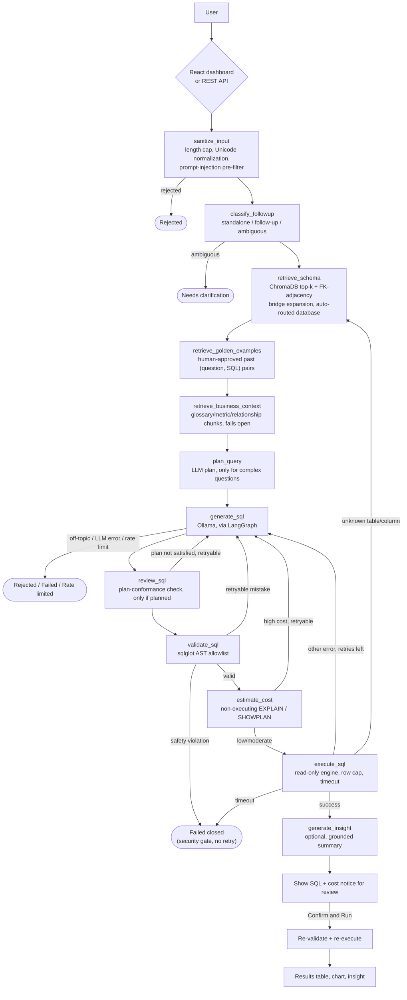

<div align="center">

<h1>AI-Powered Conversational Intelligence</h1>

<p><strong>Ask your own database a question in plain English — get validated, read-only SQL you review before it ever runs.</strong></p>

[User Guide](USER_GUIDE.md)&nbsp;&nbsp;&nbsp;|&nbsp;&nbsp;&nbsp;[Architecture](docs/ARCHITECTURE.md)&nbsp;&nbsp;&nbsp;|&nbsp;&nbsp;&nbsp;[API Reference](docs/API.md)&nbsp;&nbsp;&nbsp;|&nbsp;&nbsp;&nbsp;[Configuration](docs/CONFIGURATION.md)

[](LICENSE)
[](USER_GUIDE.md)
[](#-project-status)

</div>

> **Advanced beta — pre-production hardening.** The platform builds,
> deploys and runs: the production container image was verified on
> 2026-10-17 to build and import every module on its target Python 3.11,
> and the core workflows, authorization and data-protection controls were
> driven end to end against live databases and a live local model.
> **It is not production-ready and UAT has not been run** — three
> blocking CI gates are red on verified-benign findings awaiting a
> decision, capacity and container-CVE testing are unblocked but unrun,
> recovery has never been drilled, and no business user has executed or
> signed off a single acceptance journey. See
> [Project status](#-project-status).

<a id="news-and-updates"></a>

## 📰 News and Updates

<!-- Newest first, sourced from real commit history. Keep no more than the three most recent entries. -->

- **2026-10-21** — A code-specialised model now drafts the SQL, its weights live off the system drive, and a hole in the SQL validator that only SQL Server could fall through is closed. `qwen2.5-coder:7b` is pulled and selectable, and Ollama's model store moved to `D:\OllamaModels` — which mattered more than tidiness, since `C:` was down to **12.4 GB free** and the existing `qwen3.8:27b` and `llama3.1:8b` (21.1 GB together) were sitting on it. They were **copied, verified file-by-file and left in place**, not moved, so a failed migration could not cost anything. The instructive part is the failure *mode*: setting `OLLAMA_MODELS` at user scope and restarting Ollama was **not enough**, and the pull still filled `C:`. Two reasons, both invisible unless you look — `[Environment]::SetEnvironmentVariable(..., "User")` writes the registry but does not update the shell you typed it in, and the tray app does not inherit the launching shell's environment either, so the server kept starting with the old path. Its own log said so plainly (`OLLAMA_MODELS:C:\Users\...\.ollama\models`) while the variable read back as `D:` the whole time; the only honest check is **which directory actually grows during a pull**. Separately, probing the validator with destructive SQL turned up a real gap: it rejected `sys.databases` but not SQL Server's pre-2005 compatibility views, which resolve *unqualified* from any database — `sysobjects`, `syscolumns`, and `syscomments`, which exposes the **source text** of views and procedures. The bare-name hole was already covered for PostgreSQL (`pg_*`) and Oracle (`DBA_*`/`ALL_*`); mssql was the one dialect missing it, and this deployment runs mssql. It is matched as a **curated set of exact names, never a blind `sys*` prefix**, so `system_settings` and `sysadmin_audit` still work — removing the check fails six tests. **Measured, not assumed:** the 7B model does *not* fit the 4 GB VRAM on this machine and runs **59% CPU / 41% GPU** at **8.8 tok/s**, which is marginally *faster* per token than the previous default; a warm two-question pipeline run took **75.6s** against `llama3.1:8b`'s 83s, while the same run cold took 783s — load overhead, not model speed. It also declined one of the two questions rather than answer it, which on inspection is the better behaviour: auto-routing had sent "top 5 companies" to a database with no company table, and the previous model answered anyway by joining an unrelated one and returning zero rows. **Not done, and worth knowing before you trust a number:** no accuracy benchmark was re-run, so `docs/EVALUATION_CURRENT.md`'s figures still describe `llama3.1:8b` and no longer describe the default — one `.env` line switches back. See [`docs/CONFIGURATION.md`](docs/CONFIGURATION.md#where-ollama-stores-model-files) and [`docs/TROUBLESHOOTING.md`](docs/TROUBLESHOOTING.md).

- **2026-10-17 (later)** — The one thing standing between this project and a deployable artefact is fixed, and the project status moves to **advanced beta / pre-production hardening**. A certification pass that morning had returned **NO-GO** on a single release-blocking defect: `requirements.txt` pinned `scipy==1.18.1`, which declares `Requires-Python: >=3.12`, while the Dockerfile's base is `python:3.11-slim` and every CI job pins 3.11 — so `pip` resolved no candidate and the production image could not be built at all. The instructive part is the failure *mode*: an unsatisfiable pin fails at the dependency-install step, so the test suite never runs and "a bad pin would show up in tests" simply does not apply — there are no test results to read. It is now `scipy==1.17.1`, which publishes cp311 *and* cp314 wheels and so satisfies both the 3.11 target and this machine's 3.14 dev venv with one pin rather than a marker that would let the two drift apart again. **Verified rather than argued:** the image runs `python 3.11.16` with `scipy 1.17.1`, all five scipy-dependent production modules (`analytics/causal.py`, `forecasting.py`, `models.py`, `predictive.py`, `optimization/engine.py`) import inside it, and the full backend suite re-ran clean at **7,274 passed / 0 failed**. The same pass drove the running application end to end for the first time on record — the SQL validator refusing a hand-edited `UPDATE`, a `DROP`, a stacked statement and a `sys.tables` reference; the row cap injected into the SQL text as `SELECT TOP 1000`; compensation columns returned as `[restricted]` against a bare `SELECT *`; and 14 of 14 admin routes refused server-side for a `user` role. It also found a new defect worth knowing about before you demo this: with several databases configured, auto-routing picks on *schema similarity alone* and chose a schema-rich but **data-empty** database over the one holding the answer — returning zero rows, correctly refusing to invent any, with no way for a user to redirect the question. **Still not production-ready:** three blocking CI gates (`ruff`, `bandit`, `pip-audit`) are red on verified-benign findings, container-CVE and load testing are now unblocked but unrun, and **UAT remains NOT COMPLETED**. See [`docs/certification/2026-10-17_release_gate_v2.md`](docs/certification/2026-10-17_release_gate_v2.md) §11.

- **2026-10-17** — The generated-SQL panel now says what the SQL *does*, the admin panels say what the models consumed, and the component suite checks accessibility at runtime. `agent.sql_validator.describe_sql` reads the AST `validate_sql` has **already parsed** and reports the joins (the parser's own `INNER`/`LEFT`/`RIGHT`/`FULL`/`CROSS` side, never guessed from the text), the columns filtered on, the aggregates, the `GROUP BY` grain, the statement-level `ORDER BY` and whether `DISTINCT` applies — no second parser, no model call, because an explanation that hallucinated a join would render beside a real validator verdict and read as authoritative. It deliberately reports **no row limit** (the `TOP n` you see is this platform's governance cap, not the query's intent), no business meaning, and no filter *values* — column names only. Separately, the Ollama token counts `agent/llm_client.py` had been reading and discarding for months are now rolled up per model and shown on the two existing metrics routes and admin panels, **with no monetary figure anywhere**: the model runs locally, so there is no per-token price, and inventing one would present a guess as an observed fact (three tests pin its absence). And oxlint turned out to ship a `jsx-a11y` plugin that was simply never enabled — enabling it cost zero dependencies and found 28 issues, while an `axe-core` helper now checks the *rendered* tree, which is what proved three of those static rules were false positives. Colour contrast is still unchecked and cannot be checked under jsdom — stated rather than glossed. Also added: `agent/translation.py`, which preserves every number, date, citation and `[restricted]` mask byte-for-byte or discards the translation entirely — **built, not wired**, with no live caller. See [`CHANGELOG.md`](CHANGELOG.md) and [`docs/ai-capability-implementation-log.md`](docs/ai-capability-implementation-log.md).

<a id="example-usage"></a>

## 💻 Example Usage

The REST API (`api/`, FastAPI) is a thin wrapper over the same LangGraph
agent the React dashboard calls — `POST /ask` works standalone, with or
without the dashboard built/running:

```bash
curl -X POST http://localhost:8000/ask \
  -H "Content-Type: application/json" \
  -d '{
        "question": "What were total sales last quarter?",
        "enable_insight": true
      }'
```

Add `-H "Authorization: Bearer $API_AUTH_TOKEN"` if you've set
`API_AUTH_TOKEN` in `.env` (unset by default — see
[`docs/API.md`](docs/API.md)). The response includes the generated SQL,
result rows, retry/attempt history, and (if enabled) a grounded
plain-English insight — see `api/schemas.py::AskResponse` for the full
shape.

`POST /ask` answers one question and blocks until it has an answer. To run
**many questions at once as a single user**, submit them to the
asynchronous queue instead — it returns a job id immediately and runs the
question through the identical governed pipeline:

```bash
# Submit; returns 202 with {"job_id": "...", "status": "queued"}
curl -X POST http://localhost:8000/questions   -H "Content-Type: application/json"   -H "Authorization: Bearer $TOKEN"   -d '{"question": "What were total sales last quarter?"}'

# Poll it; add /cancel to stop it, or GET /questions for all of yours
curl -H "Authorization: Bearer $TOKEN" http://localhost:8000/questions/$JOB_ID
```

Up to `MAX_CONCURRENT_QUESTIONS_PER_USER` (default 100) run at once per
user; the rest **queue** rather than being refused. This path requires a
real user account (`LOCAL_AUTH_ENABLED` or OIDC), since a job has to
belong to someone. See [`docs/CONCURRENCY.md`](docs/CONCURRENCY.md).

<a id="get-started-and-stay-tuned"></a>

## 🌟 Get Started & Stay Tuned

<div align="center">


</div>

_An animated diagram, not a screen recording — a real screenshot of the
chat + generated-SQL view is still TODO._

Ready to try it? Jump to [Getting Started](#-getting-started) below.

We're glad you're here — [star the repository](https://github.com/surajkumarnavodya/ai-powered-conversational-intelligence)
if you want to keep it on your radar, and open an
[issue](https://github.com/surajkumarnavodya/ai-powered-conversational-intelligence/issues/new/choose)
for bugs, questions, or feature ideas.

<a id="what-is-this"></a>

## 🔎 What is this?

**A Text-to-SQL dashboard connected to one or more real, user-configured
databases.** A user asks a natural-language question, a LangGraph agent
turns it into SQL against the configured database (schema retrieved via
ChromaDB, embedded from live schema introspection — not a hardcoded
sample), the SQL is validated (SELECT-only allowlist, AST-parsed with
`sqlglot`) and executed read-only, and the result is rendered as a table +
auto-picked chart. The LLM runs locally via Ollama — no network calls for
generation, no API keys required for that part. Database connectivity is
fully config-driven via `.env`; there is no hardcoded connection string,
host, or schema anywhere in the codebase.

<div align="center">


</div>

<a id="choose-your-interface"></a>

## 🧭 Choose your interface

| Interface | Status | Run it |
|---|---|---|
| **React dashboard** (`frontend/`) | The only UI this project ships — theme/accent/font/language pickers, installable as a PWA, chat history | `npm run build` in `frontend/`, then `uvicorn api.main:app` serves it at `http://localhost:8000/` |
| **REST API** (`api/`) | No UI — for scripts, notebooks, or your own frontend | `uvicorn api.main:app` → see [`docs/API.md`](docs/API.md) |

Both drive the identical `agent.graph.run_agent` (or, with multi-source
routing enabled, `agent.orchestrator.graph.run_orchestrated`) — no logic is
duplicated per interface. A Streamlit app used to ship alongside the React
dashboard; it was removed once the dashboard reached full feature parity
(history note, like the earlier bundled-DuckDB removal — see CLAUDE.md).

<a id="why-this-project"></a>

## 💡 Why this project

- **The LLM's SQL is never trusted implicitly.** `sqlglot` parses the AST
  and allowlists the statement type (`SELECT`/`UNION`/`EXCEPT`/`INTERSECT`
  only) — an explicit allowlist, not a keyword blocklist that a syntax
  variant could slip past.
- **A self-correcting retry loop, not a free-form agent.** The pipeline is
  an explicit 12-node LangGraph state machine (see the diagram below); a
  review/validation/execution failure routes back to regeneration with the
  error appended to context, capped at an adaptively-widened retry budget —
  inspectable and boundable, not implicit ReAct-style reasoning.
- **Schema-aware retrieval**, not "dump the whole schema into the prompt."
  Each table's DDL is embedded in ChromaDB; only the top-k relevant tables
  are retrieved per question, with FK-adjacency bridge expansion to pull in
  structurally-required tables plain similarity search tends to miss.
- **A golden-dataset feedback loop.** Human-approved (question, SQL) pairs,
  saved via a thumbs-up on a confirmed result, are retrieved as few-shot
  examples for similar future questions.
- **Multi-database auto-routing.** More than one database can be configured
  at once; each question is routed to whichever one's schema looks most
  relevant — no manual picker.
- **Optional multi-source agentic RAG** (off by default) — a router can fan
  a question out across the SQL pipeline, uploaded PDF documents, a
  separate sensitivity-gated policy collection, and live web search
  (Tavily), attributing each source's contribution under its own heading.
- **Optional image/video generation** (off by default) — the same router
  recognizes a request that explicitly asks to *create* new media (e.g.
  "generate an image of monthly spend by category") via IMA Studio, and
  renders the actual result inline as real media, never a bare link. A
  plain "show me the data" question is never mistaken for one. Generation
  is the one source that spends real money, so it requires an explicit
  human confirmation before anything is actually generated — the same
  "Confirm and Run" philosophy the SQL pipeline already applies, extended
  to this source.
- **Voice mode** (on by default) — press the mic, speak a question (local
  `faster-whisper` transcription, schema-aware so real table/column names
  are recognized correctly, with live word-by-word captions as you talk),
  it's submitted automatically once you stop talking, and the answer is
  read back automatically (local Piper text-to-speech) — then it resets to
  the normal composer, one question and one spoken answer per press,
  matching Google Assistant/ChatGPT's "press to talk" turn shape.
  Transcription and synthesis are fully local, same as the LLM itself — no
  cloud speech API, no data leaving the machine for either — and a typed
  question never triggers spoken output. (Live captions are the one
  disclosed exception: they use the browser's own built-in speech
  recognition, which in Chromium browsers is cloud-backed; the actual
  submitted transcript still comes from local Whisper.)
- **Optional media search** (off by default) — search a local, *untagged*
  image/video library by plain-English content description (e.g. "find the
  photo of the site inspection," "show me the clip where the crane lifts
  the beam"), routed as its own orchestrator source or usable directly via
  a standalone search page. No filenames or manual tags needed: images are
  embedded with a local CLIP model, videos are segmented at scene-change
  boundaries with each segment transcribed (local Whisper), OCR'd, and
  optionally captioned (a local Ollama vision model). Fully local by
  default, same as the LLM itself — no hosted embedding API, no cost per
  image indexed. Off by default (unlike voice mode) since it needs a real
  library folder configured and pulls in a meaningfully larger dependency
  footprint (`torch`, OpenCV).
- **Grounded insights, not free-form narration.** An optional plain-English
  summary sentence is checked against the actual result data before it's
  shown; an unsupported number is silently dropped rather than displayed as
  if verified.
- **Fully local LLM stack.** Ollama runs on your machine — no data leaves
  it for SQL generation (the opt-in exceptions are live web search and
  voice mode, both disabled by default and both fully local when voice
  mode is the one enabled).

<details>
<summary>Full agent graph (12 nodes)</summary>



See [`docs/ARCHITECTURE.md`](docs/ARCHITECTURE.md) for the full per-node
walkthrough and retry-routing table.

</details>

<a id="getting-started"></a>

## 🚀 Getting Started

### Prerequisites

- **Python 3.11** (the project's target — see `pyproject.toml` /
  `.github/workflows/ci.yml`)
- **[Ollama](https://ollama.com)**, installed and running, with a model pulled:
  ```bash
  ollama pull llama3.1:8b          # the project default
  ollama pull qwen2.5-coder:7b     # code-specialised alternative
  ```
  Models are several GB each. To keep them off a small system drive, set
  Ollama's own `OLLAMA_MODELS` variable *before* starting Ollama (Windows
  example: `D:\OllamaModels`) — this app never reads that variable, it only
  talks to `OLLAMA_HOST`. See
  [`docs/CONFIGURATION.md`](docs/CONFIGURATION.md#where-ollama-stores-model-files),
  including the Windows gotcha where a running server keeps the old path.
- **A database to connect to** — PostgreSQL, MySQL, SQL Server, or Oracle
  (see [Supported models & databases](#-supported-models--databases) below).
  No sample database is bundled.
- **Node.js + npm** (a recent LTS) — needed to build the React dashboard
  (the only UI this project ships); the REST API on its own doesn't
  require it.

### Clone, install, configure

```bash
git clone https://github.com/surajkumarnavodya/ai-powered-conversational-intelligence.git
cd ai-powered-conversational-intelligence
python -m venv .venv
source .venv/bin/activate        # Windows: .venv\Scripts\Activate.ps1
pip install --upgrade pip
pip install -r requirements-dev.txt   # or requirements.txt for a runtime-only install
cp .env.example .env             # Windows: Copy-Item .env.example .env
```

Edit `.env` with your real database connection details (every variable is
documented inline in `.env.example`) — **use a dedicated read-only database
account**, not an admin login (see [`SECURITY.md`](SECURITY.md)). Then
verify the connection and build the schema index:

```bash
python scripts/test_db_connection.py
python scripts/build_embeddings.py
```

### Business-context vector retrieval (optional, recommended)

On top of the schema index above, the agent can also retrieve business
glossary terms, metric definitions, table/column/relationship descriptions,
curated SQL examples, and documentation — see
[`docs/vector-retrieval-design.md`](docs/vector-retrieval-design.md) for
the full design. It's additive and fails open (the app works identically
with none of this ingested — see that doc's "Fallback behavior" section),
but improves context recall once ingested:

```bash
# Preview what would be ingested, without embedding or writing anything:
python -m scripts.ingest_schema --database-id default --dry-run

# Actually ingest (safe to re-run any time -- only changed chunks are
# re-embedded; see the design doc's "Ingestion strategy" section):
python -m scripts.ingest_schema --database-id default
```

(`--database-id` matches one of `Settings.databases`' names — `default`
for a plain single-database `.env`, or the name you gave it under
`DB_CONNECTIONS` for a multi-database setup.)

Sample glossary/metric/SQL-example/documentation content lives under
[`data/knowledge/`](data/knowledge/) — replace it with your own before
relying on this in production (the shipped samples are clearly labeled
demonstration content, not reviewed business documentation).

If you ever need to fully rebuild a database's business-context index
(e.g. after changing `RETRIEVAL_SIMILARITY_METRIC`, which — like the
schema-DDL collection above — is fixed at collection-creation time):

```bash
python -m scripts.rebuild_index --database-id default
```

### User accounts, universal chat history & password policy (optional)

Set `LOCAL_AUTH_ENABLED=true` (plus `AUTH_DATABASE_URL`, a dedicated
PostgreSQL database, and `JWT_SECRET_KEY` — see `.env.example`) to enable
this app's own self-hosted accounts. See
[`docs/AUTHENTICATION.md`](docs/AUTHENTICATION.md) for the full picture;
this section covers only what's new in this pass:

- **Display name is mandatory at sign-up** and **passwords must clear a
  real strength policy** (12+ characters, no common/patterned passwords,
  nothing containing your email/name) — see
  [`docs/authentication-and-password-policy.md`](docs/authentication-and-password-policy.md).
- **Chat history is server-side and universal**: once signed in with a
  local account, every conversation is stored in the identity database and
  follows you across browsers and devices — logging out, a session
  expiring, or an app restart never deletes it. See
  [`docs/chat-history-architecture.md`](docs/chat-history-architecture.md)
  and [`docs/chat-history-search.md`](docs/chat-history-search.md).

Run the identity database's migrations before first use (or after pulling
an update that touches `identity/models.py`):

```bash
alembic -c identity/alembic.ini upgrade head
```

### Run it

**Build and serve the React dashboard (recommended):**
```bash
cd frontend && npm install && npm run build && cd ..
uvicorn api.main:app --host 0.0.0.0 --port 8000
```
Open `http://localhost:8000/` — the same FastAPI process serves both the
API and the dashboard's built static files (see `api/main.py`'s
`StaticFiles` mount).

**Frontend hot-reload during active frontend development:** run the API
as above in one terminal, then in a second terminal:
```bash
cd frontend && npm run dev
```
Open `http://localhost:5173/` — Vite proxies `/ask`, `/execute`,
`/documents`, `/schema`, `/feedback`, `/health`, `/media`, `/generate`,
`/voice`, and `/search` to the API on port 8000 (see
`frontend/vite.config.ts`), so no CORS setup is needed either way.

**REST API only** (no UI): `uvicorn api.main:app --host 0.0.0.0 --port 8000` —
see [`docs/API.md`](docs/API.md).

### Tests and linters

```bash
pytest
ruff check . && black --check . && mypy .
```

PowerShell equivalents are in `tasks.ps1` (`.\tasks.ps1 run`,
`.\tasks.ps1 test`, `.\tasks.ps1 lint`); Make targets for bash are in the
`Makefile`. CI (`.github/workflows/ci.yml`) runs the same lint + test steps
on GitHub Actions — with one difference worth knowing: **`mypy` is
report-only there** (`continue-on-error`, and last in the job, so a type
error cannot stop `bandit`/`pytest`/`pip-audit` from running). A type error
will therefore *not* turn CI red. Treat it as a real defect anyway; the
standing backlog is in [`CLAUDE.md`](CLAUDE.md) §13.

**Frontend tests** (`frontend/`, vitest + React Testing Library — added
alongside the UI overhaul below, previously no test runner existed):

```bash
cd frontend
npm run test        # vitest run -- one-shot
npm run test:watch  # vitest -- watch mode
npm run lint         # oxlint (incl. the jsx-a11y rules)
npm run build        # tsc -b && vite build (also the typecheck)
```

Accessibility is checked at two levels: `oxlint`'s static `jsx-a11y` rules,
and `axe-core` against the **rendered** tree in
`frontend/src/components/ui/accessibility.test.tsx`, which catches what
static rules structurally cannot — a control that ends up with no
accessible name once components compose. **Colour contrast is not covered
and cannot be**: jsdom has no layout engine, so that rule is explicitly
disabled rather than left to report a misleading pass. See
[Known limitations](#known-limitations).

### Frontend UI

The React dashboard has a persistent left sidebar (conversation history +
search, replacing an earlier combined history/settings drawer — see
[`docs/ui-design-system.md`](docs/ui-design-system.md) and
[`docs/chat-history-ui.md`](docs/chat-history-ui.md)), collapsible on
desktop to a narrow icon rail via the header's sidebar toggle (the
collapsed/expanded preference persists across sessions, `localStorage`
only, never chat content), a single consolidated account menu (avatar,
top-right — display name/email, Settings, Theme, Sign out; previously
duplicated as two independent copies of Settings and Sign out, see
[`docs/ui-production-audit.md`](docs/ui-production-audit.md) and
[`docs/navigation-and-actions.md`](docs/navigation-and-actions.md) for the
one-owner-per-action rule that replaced it), a Stop button that genuinely
cancels an in-flight question (`AbortController`, no fake token stream),
and an optional attachment (image, PDF, DOCX, XLSX, PPTX, TXT, MD, CSV,
JSON) + local image editor (crop/draw/annotate/undo-redo) in the composer.
Attachments are real, not local-only: each one is uploaded, validated,
malware-scanned (if configured), and processed server-side, and the model
genuinely sees its content — a vision model's description or an OCR
fallback for images, extracted text for documents — via a dedicated
LangGraph subgraph (see "Known limitations" below and `CLAUDE.md`'s "Chat
attachments, image actions, and their security hardening" section). The
image editor's own "AI-guided editing" panel
(natural-language-prompted generative edits — "remove the selected
object," "replace the sky") is also real, provider-backed editing now
(IMA Studio, off by default via `ENABLE_IMAGE_EDITING`), not a stub — see
[`docs/image-editing-architecture.md`](docs/image-editing-architecture.md)
for the full design, the mask-conveyance approach IMA's lack of a native
mask parameter required, and disclosed limitations.

### Running with Docker

```bash
cp .env.example .env   # then edit .env as above
docker compose build
docker compose up -d
docker compose exec api python scripts/build_embeddings.py
docker compose exec api python -m scripts.ingest_schema --database-id default   # optional, see below
```

This builds the React dashboard (a Node build stage) and bakes it into the
same image as the API (a Python stage) — one container, serving both the
REST API and the dashboard at `http://localhost:8000`. See
[`docs/DEPLOYMENT.md`](docs/DEPLOYMENT.md) for external Ollama/database
connectivity and reverse-proxy placement.

<a id="explore-the-documentation"></a>

## 📚 Explore the documentation

| Goal | Start here |
|---|---|
| Just use the app | [`USER_GUIDE.md`](USER_GUIDE.md) |
| Understand the LangGraph node design and retry logic | [`docs/ARCHITECTURE.md`](docs/ARCHITECTURE.md) |
| Understand business-context vector retrieval (glossary/metrics/SQL examples) | [`docs/vector-retrieval-design.md`](docs/vector-retrieval-design.md) |
| Evaluate retrieval quality | [`docs/retrieval-evaluation.md`](docs/retrieval-evaluation.md) |
| Turn on document RAG, policy RAG, or web search | [`docs/MULTI_SOURCE_GUIDE.md`](docs/MULTI_SOURCE_GUIDE.md) |
| Understand the source connector contract, the source picker, the REST connector and the MCP client | [`docs/architecture/source-connector-contract.md`](docs/architecture/source-connector-contract.md) |
| See which capability is actually implemented, and how it was verified | [`docs/architecture/feature-inventory.md`](docs/architecture/feature-inventory.md) |
| Compare source types by capability, auth model and ACL fidelity | [`docs/architecture/data-source-matrix.md`](docs/architecture/data-source-matrix.md) |
| Run the opt-in live tests, or set up a Microsoft 365 tenant for them | [`docs/LIVE_INTEGRATION_TESTING.md`](docs/LIVE_INTEGRATION_TESTING.md) |
| Look up REST API endpoints and auth | [`docs/API.md`](docs/API.md) |
| Find every `.env` variable | [`docs/CONFIGURATION.md`](docs/CONFIGURATION.md) |
| Understand why results show business names instead of database keys | [`docs/DISPLAY_NAMES.md`](docs/DISPLAY_NAMES.md) |
| Run many questions at once per user, or tune source/model routing, guardrails and grounding | [`docs/CONCURRENCY.md`](docs/CONCURRENCY.md) |
| Deploy with Docker / an external DB or Ollama | [`docs/DEPLOYMENT.md`](docs/DEPLOYMENT.md) |
| See the latest measured benchmark accuracy | [`docs/EVALUATION.md`](docs/EVALUATION.md) |
| Diagnose a common failure mode | [`docs/TROUBLESHOOTING.md`](docs/TROUBLESHOOTING.md) |
| Understand this project's security posture | [`SECURITY.md`](SECURITY.md) |
| Set up OIDC login and RBAC roles | [`docs/AUTHENTICATION.md`](docs/AUTHENTICATION.md), [`docs/AUTHORIZATION.md`](docs/AUTHORIZATION.md) |
| Understand universal server-side chat history | [`docs/chat-history-architecture.md`](docs/chat-history-architecture.md), [`docs/chat-history-search.md`](docs/chat-history-search.md) |
| Understand the display-name/password-strength requirements | [`docs/authentication-and-password-policy.md`](docs/authentication-and-password-policy.md) |
| See what the chat-history feature replaced and why | [`docs/chat-history-authentication-audit.md`](docs/chat-history-authentication-audit.md) |
| Understand the frontend's design tokens (colors, spacing, motion, theming) | [`docs/ui-design-system.md`](docs/ui-design-system.md) |
| Understand the sidebar/history/search UI (not the backend behind it) | [`docs/chat-history-ui.md`](docs/chat-history-ui.md) |
| See which UI action lives where (Settings, Theme, Logout, sidebar collapse, ...) and why | [`docs/navigation-and-actions.md`](docs/navigation-and-actions.md) |
| See the duplicated controls a later UI pass found and removed (two settings dialogs, two logout buttons, no sidebar collapse) | [`docs/ui-production-audit.md`](docs/ui-production-audit.md) |
| Understand the local Konva image editor, including real AI-guided (generative) editing via IMA Studio | [`docs/image-editing-architecture.md`](docs/image-editing-architecture.md) |
| See the full frontend audit this UI pass started from | [`docs/frontend-ui-audit.md`](docs/frontend-ui-audit.md) |
| See the live, browser-verified root-cause investigation of reported Settings/search/New-Chat/image-attachment issues | [`docs/functional-ui-audit.md`](docs/functional-ui-audit.md) |
| Understand exactly how the Settings modal's overlay/focus/keyboard behavior works | [`docs/settings-modal.md`](docs/settings-modal.md) |
| Understand the New Chat lazy-persistence flow and its duplicate-creation safeguards | [`docs/new-chat-flow.md`](docs/new-chat-flow.md) |
| See the historical record of the image-attachment gap this project closed (superseded — see `CLAUDE.md`'s "Chat attachments, image actions, and their security hardening" section for the current pipeline) | [`docs/image-attachment-flow.md`](docs/image-attachment-flow.md) |
| See a point-in-time production-UI checklist and what it found | [`docs/production-ui-checklist.md`](docs/production-ui-checklist.md) |
| Understand the root cause of the dark-mode Settings-modal transparency bug and its fix | [`docs/settings-modal-visual-bug.md`](docs/settings-modal-visual-bug.md) |
| Understand the generic Tool/MCP abstraction (`agent/tools/`) — what it wraps, why the orchestrator doesn't call it yet | [`docs/TOOLS.md`](docs/TOOLS.md) |
| Share a conversation (invite-only or "anyone with the link") — RBAC/ABAC model, token lifecycle, snapshot rules | [`docs/SHARING_SECURITY.md`](docs/SHARING_SECURITY.md) |
| Understand what's suitable for multi-instance deployment today vs. not (bounded `/ask` concurrency, identity-keyed rate limits, trusted-proxy IPs) and the measured load-test baseline | [`docs/ENTERPRISE_SCALABILITY_SECURITY_ASSESSMENT.md`](docs/ENTERPRISE_SCALABILITY_SECURITY_ASSESSMENT.md), [`docs/SCALE_BASELINE.md`](docs/SCALE_BASELINE.md) |
| See what this app actually logs/emits today (correlation IDs, per-stage timing, health checks) with no monitoring-stack dependency | [`docs/OBSERVABILITY.md`](docs/OBSERVABILITY.md) |
| See the full platform-transformation discovery/assessment/roadmap this and other recent passes were scoped from | [`docs/PLATFORM_TRANSFORMATION_ASSESSMENT.md`](docs/PLATFORM_TRANSFORMATION_ASSESSMENT.md), [`docs/DEEP_FEATURE_PERFORMANCE_ASSESSMENT.md`](docs/DEEP_FEATURE_PERFORMANCE_ASSESSMENT.md) |
| See the live performance-metrics rollup (`GET /metrics/performance`) | [`docs/API.md`](docs/API.md) |
| Check production readiness before deploying | [`docs/PRODUCTION_CHECKLIST.md`](docs/PRODUCTION_CHECKLIST.md), [`docs/PRODUCTION_READINESS_REPORT.md`](docs/PRODUCTION_READINESS_REPORT.md) |
| Governance, compliance, responsible-AI, risk tracking | [`docs/GOVERNANCE.md`](docs/GOVERNANCE.md), [`docs/COMPLIANCE.md`](docs/COMPLIANCE.md), [`docs/RESPONSIBLE_AI.md`](docs/RESPONSIBLE_AI.md), [`docs/RISK_REGISTER.md`](docs/RISK_REGISTER.md) |
| Use the AI Data Analyst agent (`POST /analyst/investigate`): the bounded multi-step loop, its budgets, and its evidence model | [`33_AI_DATA_ANALYST_AGENT_CONTRACT.md`](33_AI_DATA_ANALYST_AGENT_CONTRACT.md) |
| Use the multi-agent supervisor (`POST /analyst/supervise`): specialist agents, tool allowlists, circuit breakers, and the benchmark against the analyst | [`34_MULTI_AGENT_SUPERVISOR_CONTRACT.md`](34_MULTI_AGENT_SUPERVISOR_CONTRACT.md) |
| Use semantic intelligence (synonyms, ambiguity, conflicts, impact, the risk-ordered review queue) | [`35_SEMANTIC_INTELLIGENCE_CONTRACT.md`](35_SEMANTIC_INTELLIGENCE_CONTRACT.md) |
| Contribute a change or an eval case | [`CONTRIBUTING.md`](CONTRIBUTING.md) |

<a id="supported-models-and-databases"></a>

## 🧩 Supported models & databases

Ollama is the only supported LLM runtime — there is no hosted-API code
path. Any `ollama pull`-able model works; `OLLAMA_MODEL` is a plain config
string (`config/settings.py`), not hardcoded:

| Model | Notes |
|---|---|
| `llama3.1:8b` (default) | What this project is built and benchmarked against — see [`docs/EVALUATION.md`](docs/EVALUATION.md) for measured accuracy. |
| `sqlcoder`, `duckdb-nsql`, or any other Ollama-hosted model | Supported by the same config knob; untested by this project's own benchmark as of this writing. |

**Per-question model selection**: a caller (or the dashboard's own "AI
Model" picker, in Settings) can choose a different Ollama model per
question via `POST /ask`'s optional `model` field, without touching
`OLLAMA_MODEL`/any code — validated server-side against
`OLLAMA_ALLOWED_MODELS` (a small, practical starter set out of the box:
`qwen2.5:7b`, `qwen2.5:14b`, `llama3.2:3b`, `mistral:7b`, `deepseek-r1:8b`,
alongside the configured default) and cross-checked live against what's
actually `ollama pull`ed on the connected server via `GET /models`. See
[`docs/CONFIGURATION.md`](docs/CONFIGURATION.md#model-selection) for the
full design (why the online Ollama Library is never a runtime dependency,
how to add/remove a model, request-scoping guarantees).

| `DB_TYPE` | Driver | Notes |
|---|---|---|
| `postgresql` | `psycopg2-binary` | |
| `mysql` | `pymysql` | |
| `mssql` | `pyodbc` | Requires the Microsoft ODBC Driver for SQL Server installed as a system package — see [`docs/TROUBLESHOOTING.md`](docs/TROUBLESHOOTING.md). |
| `oracle` | `oracledb` (thin mode) | No separate Oracle Client install needed. |

Selected via `DB_TYPE` in `.env` (single database) or `DB_CONNECTIONS=name1,name2,...`
(multiple, auto-routed per question — see [`docs/CONFIGURATION.md`](docs/CONFIGURATION.md)).
Source of truth: `db/connection.py::SUPPORTED_DB_TYPES`.

<a id="get-help-and-file-an-issue"></a>

## 🛟 Get help and file an issue

Use the [issue chooser](https://github.com/surajkumarnavodya/ai-powered-conversational-intelligence/issues/new/choose)
(bug report / feature request templates under `.github/ISSUE_TEMPLATE/`)
for usage questions, reproducible bugs, and feature requests.

Follow [`SECURITY.md`](SECURITY.md) to report a suspected security
vulnerability rather than filing a public issue.

<a id="project-status"></a>

<a id="feature-matrix"></a>

## 🧾 Feature matrix

Status vocabulary is deliberate. **Verification** is the column that
matters: a capability can be fully implemented and still never have met a
real provider, and this table says so rather than letting "implemented"
imply "proven".

| Status | Meaning |
|---|---|
| `IMPLEMENTED_AND_TESTED` | wired into a request path, covered by the mocked suite |
| `IMPLEMENTED_BUT_NOT_FULLY_TESTED` | implemented, but a material path is unverified |
| `PARTIALLY_IMPLEMENTED` | narrower than the name suggests |
| `DOCUMENTED_BUT_NOT_IMPLEMENTED` | described somewhere, no implementation |
| `PLANNED` | agreed, not started |

**Verification**: *mocked* = the fully-mocked pytest suite (no real DB, no
Ollama). *live* = exercised against real infrastructure. *blocked* = cannot
be verified here; the reason is named.

### Core pipeline

| Capability | Status | Verification | Docs |
|---|---|---|---|
| Text-to-SQL (18-node LangGraph pipeline) | `IMPLEMENTED_AND_TESTED` | mocked; accuracy measured in a dated benchmark (see Known limitations) | [`docs/ARCHITECTURE.md`](docs/ARCHITECTURE.md) |
| AST SELECT-only SQL validation | `IMPLEMENTED_AND_TESTED` | mocked + `tests/security/` | [`SECURITY.md`](SECURITY.md) |
| Live schema introspection → ChromaDB | `IMPLEMENTED_AND_TESTED` | mocked | [`docs/architecture/overview.md`](docs/architecture/overview.md) |
| Multi-database auto-routing | `IMPLEMENTED_AND_TESTED` | mocked | [`docs/architecture/overview.md`](docs/architecture/overview.md) |
| Result governance / restricted columns | `IMPLEMENTED_AND_TESTED` | mocked | [`docs/DATA_PRIVACY_GOVERNANCE_ENGINE.md`](docs/DATA_PRIVACY_GOVERNANCE_ENGINE.md) |
| Follow-up questions | `IMPLEMENTED_AND_TESTED` | mocked; per-request, not checkpointed | [`docs/ARCHITECTURE.md`](docs/ARCHITECTURE.md) |
| Generated-SQL structural description (joins, filters, aggregates, grain) | `IMPLEMENTED_AND_TESTED` | mocked; read from the parsed AST, no LLM call | [`docs/API.md`](docs/API.md) |

### Sources

| Capability | Status | Verification | Docs |
|---|---|---|---|
| SQL databases (PostgreSQL, MySQL, SQL Server, Oracle) | `IMPLEMENTED_AND_TESTED` | mocked; live via `scripts/test_db_connection.py` | [`docs/CONFIGURATION.md`](docs/CONFIGURATION.md) |
| File attachments (PDF/DOCX/XLSX/PPTX/TXT/CSV/JSON) | `IMPLEMENTED_AND_TESTED` | mocked | [`docs/FILE_UPLOAD_SECURITY.md`](docs/FILE_UPLOAD_SECURITY.md) |
| Document + policy RAG | `IMPLEMENTED_BUT_NOT_FULLY_TESTED` | **blocked** — needs SQL Server 2025+/Azure SQL `VECTOR` | [`docs/MULTI_SOURCE_GUIDE.md`](docs/MULTI_SOURCE_GUIDE.md) |
| Web search (Tavily) | `IMPLEMENTED_AND_TESTED` | mocked; live opt-in | [`docs/MULTI_SOURCE_GUIDE.md`](docs/MULTI_SOURCE_GUIDE.md) |
| Media search / generation | `IMPLEMENTED_BUT_NOT_FULLY_TESTED` | image generation confirmed live; video unconfirmed | [`docs/MULTI_SOURCE_GUIDE.md`](docs/MULTI_SOURCE_GUIDE.md) |
| Per-conversation source selection | `IMPLEMENTED_AND_TESTED` | mocked | [`docs/architecture/source-connector-contract.md`](docs/architecture/source-connector-contract.md) |
| REST / OpenAPI connector | `PARTIALLY_IMPLEMENTED` | mocked; **not routable** (no descriptor/orchestrator node) | [`docs/architecture/source-connector-contract.md`](docs/architecture/source-connector-contract.md) |
| MCP client (stdio) | `IMPLEMENTED_BUT_NOT_FULLY_TESTED` | mocked; **never met a real MCP server** | [`docs/architecture/source-connector-contract.md`](docs/architecture/source-connector-contract.md) |
| SharePoint, OneDrive, Dataverse, Outlook, Teams | `DOCUMENTED_BUT_NOT_IMPLEMENTED` | n/a — **zero implementation files** | [`docs/architecture/data-source-matrix.md`](docs/architecture/data-source-matrix.md) |

### Platform

| Capability | Status | Verification | Docs |
|---|---|---|---|
| Identity (local accounts, Argon2id + JWT) | `IMPLEMENTED_AND_TESTED` | mocked | [`docs/AUTHENTICATION.md`](docs/AUTHENTICATION.md) |
| OIDC sign-in | `IMPLEMENTED_BUT_NOT_FULLY_TESTED` | **blocked** — never run against a live IdP | [`docs/AUTHENTICATION.md`](docs/AUTHENTICATION.md) |
| RBAC + tenant isolation | `IMPLEMENTED_AND_TESTED` | mocked (294 tenancy tests) | [`docs/MULTI_TENANCY.md`](docs/MULTI_TENANCY.md) |
| Streaming (SSE, per-node progress) | `IMPLEMENTED_AND_TESTED` | mocked | [`docs/API.md`](docs/API.md) |
| Token-level LLM streaming | `PLANNED` | n/a | — |
| Scheduler / background worker / alert delivery | `DOCUMENTED_BUT_NOT_IMPLEMENTED` | n/a — CLI scripts are the cron entry points | [`CLAUDE.md`](CLAUDE.md) |
| Analytics, forecasting, recommendations | `IMPLEMENTED_BUT_NOT_FULLY_TESTED` | mocked; output quality unmeasured | [`docs/architecture/features-analytics.md`](docs/architecture/features-analytics.md) |
| Per-model token usage rollup | `IMPLEMENTED_AND_TESTED` | mocked; per worker, resets on restart; **no cost figure — the model is local** | [`docs/OBSERVABILITY.md`](docs/OBSERVABILITY.md) |
| Accessibility checks (static `jsx-a11y` + runtime `axe-core`) | `IMPLEMENTED_AND_TESTED` | mocked; **colour contrast not covered** — jsdom has no layout | [`docs/architecture/features-frontend.md`](docs/architecture/features-frontend.md) |
| Answer translation into a UI locale | `PARTIALLY_IMPLEMENTED` | mocked; **built, not wired** — no route, node or setting calls it | [`CHANGELOG.md`](CHANGELOG.md) |
| Multi-replica deployment | `PLANNED` | n/a — all shared state is per-process | [`docs/SCALE_BASELINE.md`](docs/SCALE_BASELINE.md) |

Opt-in live verification for the credential-blocked rows above:
[`docs/LIVE_INTEGRATION_TESTING.md`](docs/LIVE_INTEGRATION_TESTING.md).

<a id="project-status"></a>

## 🧪 Project status

This project is **advanced beta — pre-production hardening**
(status set 2026-10-17 at commit `08f385e`, on measured evidence).

**What that means, precisely, because the distinction matters:**

| Question | Answer | Evidence |
|---|---|---|
| Does it build and deploy? | **Yes** | Production image verified running `python 3.11.16` with every module importing, incl. all five scipy-dependent ones |
| Do the automated tests pass? | **Yes** | **7,274** backend (0 failed, 11 `tests/live/` deselected) · **1,161** frontend across 89 files · `tsc` clean · `black` clean over 1,635 files |
| Do the core workflows run for real? | **Yes** | 20 live end-to-end probes against 4 live SQL Server databases and local Ollama — auth, RBAC, chat history, SQL validation, row cap, restricted-column masking |
| Is CI green? | **No** | `ruff`, `bandit` and `pip-audit` each exit non-zero on **verified-benign** findings (0 High, 0 Medium) awaiting an owner decision |
| Is capacity known? | **No** | Load testing was blocked by the build defect; now unblocked, **not yet run**. No capacity claim is made anywhere |
| Is answer accuracy known? | **No** | The only full-corpus benchmark is self-disclaimed as stale — see [Known limitations](#known-limitations) |
| Has recovery been drilled? | **No** | RPO/RTO *proposed*, awaiting sign-off; no restore drill |
| **Has UAT been completed?** | **NO — NOT COMPLETED** | A 15-journey, 6-role script exists with every result cell deliberately blank. **No business user has executed or signed off anything.** Automated tests are not UAT |

**Read these two documents before forming a view**, in this order:
[`docs/certification/2026-10-17_release_gate_v2.md`](docs/certification/2026-10-17_release_gate_v2.md)
(the current verdict — **NO-GO for production, READY FOR UAT with
conditions** — with its §11 addendum carrying the live verification and
the open findings) and
[`docs/certification/UAT_SCRIPTS_AND_SIGNOFF.md`](docs/certification/UAT_SCRIPTS_AND_SIGNOFF.md)
(what acceptance testing would have to cover). Neither claims this
platform is production-ready, and nothing in this README should be read
as claiming it either.

The React dashboard is now
the only UI — a previous Streamlit app was removed once the dashboard
reached full feature parity with it. Three completed security review
passes (referenced throughout this codebase as "2026 Phase 1/2/3") have
covered authentication (OIDC + this app's own self-hosted accounts),
RBAC, the AST-based SQL validator, content moderation, audit logging,
security headers/CSP, and SSRF/CORS hardening — see
[`SECURITY_FINAL_REPORT.md`](SECURITY_FINAL_REPORT.md),
[`SECURITY_BASELINE.md`](SECURITY_BASELINE.md), and
[`SECURITY_CHANGELOG.md`](SECURITY_CHANGELOG.md) for the full, cited audit
trail, and [`SECURITY_PRODUCTION_CHECKLIST.md`](SECURITY_PRODUCTION_CHECKLIST.md)
for what still needs operator action before a production deployment.

**A later engagement went further** ([`docs/security/`](docs/security/),
distinct from the repo-root `SECURITY_*.md` files above): CI's
security gates (SAST, dependency scanning, secret scanning) are now
blocking, not just report-only; a `MalwareScanner` abstraction was added
(opt-in, fail-closed once configured — see
[`docs/security/FINAL_PRODUCTION_GATE.md`](docs/security/FINAL_PRODUCTION_GATE.md));
and a first production-readiness gate was run end-to-end. **Its verdict
is `NOT READY`** — not because a vulnerability was found (the tested
security architecture — auth, RBAC, SQL validation, SSRF, IDOR — holds up
well), but because three things this project has never had the
infrastructure to verify remain open: the frontend OIDC flow still hasn't
been exercised against a live identity provider, DAST has never been run
against this app at all, and the malware scanner above has never been
tested against a real scanner daemon. See
[`docs/security/PRODUCTION_SECURITY_READINESS_REPORT.md`](docs/security/PRODUCTION_SECURITY_READINESS_REPORT.md)
for the full, current, evidence-cited answer to "is this production
ready" — it supersedes this section and the checklist linked above where
they differ. See [Known limitations](#known-limitations) below for the
honest current state of answer accuracy — that has not changed as part of
any of this security work and remains a separate, equally real gap.

<a id="known-limitations"></a>

## ⚠️ Known limitations

- **The AI analysis layers are not yet verified against a live model or database.** The AI Data Analyst, the multi-agent supervisor and semantic intelligence are tested with the LLM, SQL and catalog boundaries mocked, or with synthetic catalog data. Their output quality on real questions is unmeasured. The supervisor's benchmark measures orchestration only, not answer quality. See each contract document's limitations section.
- **Accuracy depends heavily on the local model.** The latest full
  benchmark run (`docs/EVALUATION.md`, 57 cases, `llama3.1:8b` against
  AdventureWorksDW2025) measured **92.3% execution accuracy** (the SQL
  runs) but only **29.6% result-set accuracy** and **35.0% final
  accuracy** — the SQL often runs successfully but returns the wrong
  answer, especially on hard/real-world questions (25% pass rate on each).
  Security-rejection accuracy is 100%.

  **These figures are stale as of 2026-10-15** and have not been
  re-measured. They were taken before commit `9706fa1` (2026-10-14), which
  fixed a defect where every Ollama call silently truncated 63% of its
  prompt, including the system prompt — precisely what this benchmark
  measures. Re-running needs a live Ollama and a real database; see the
  banner at the top of [`docs/EVALUATION.md`](docs/EVALUATION.md).
- **Single-process deployment; multi-replica is not solved.** A 2026-09-26
  hardening pass (see the News entry above and
  [`docs/SCALE_OUT_PROMPT.md`](docs/SCALE_OUT_PROMPT.md)) added real
  bounded concurrency/admission control for `/ask` and fixed a genuine
  cross-user isolation gap in attachment ownership, with a measured
  baseline in [`docs/SCALE_BASELINE.md`](docs/SCALE_BASELINE.md). Still
  per-process, so a multi-worker deployment gets one of each: rate
  limiters, circuit breakers, the result cache, the schema-embedding
  index, the security-event ring buffer, and the compiled-graph/Ollama
  singletons. See [`SECURITY.md`](SECURITY.md) and
  [`docs/PRODUCTION_CHECKLIST.md`](docs/PRODUCTION_CHECKLIST.md) before
  pointing it at anything sensitive.

  *(Corrected 2026-10-15: this bullet previously said "not yet
  multi-tenant … there's no tenant isolation model". That was stale.
  Tenant isolation is implemented — `security/tenancy.py`,
  [`docs/MULTI_TENANCY.md`](docs/MULTI_TENANCY.md), 294 passing tests —
  see the row in the feature matrix below. The per-process limitation
  above is the part that was, and remains, true.)*
- **Document/policy RAG requires SQL Server 2025+ or Azure SQL**
  specifically (native `VECTOR` column type), separate from the four
  `DB_TYPE`s the core SQL pipeline supports.
- **Image/video generation (`ENABLE_MEDIA_GENERATION`, off by default)
  uses real, metered IMA Studio credits when enabled.** Image generation is
  confirmed working end-to-end against a live account; video generation
  shares the same code path but hasn't been separately confirmed with a
  live call yet.
- **Voice mode (`ENABLE_VOICE_MODE`, on by default) needs a one-time
  Piper voice download** (`python scripts/download_voice_model.py`) before
  spoken answers work — `POST /voice/synthesize` returns a clean error
  until that's done. Transcription accuracy depends on the Whisper model
  size (`STT_MODEL_SIZE`, default `base`) and your microphone/environment,
  same caveats as any local speech-to-text setup. Live captions use the
  browser's own speech recognition, so they need a Chromium-based browser
  and, in that browser, are not fully local (see `CLAUDE.md`'s "Voice
  mode" section).
- **Chat attachments (images, PDF, DOCX, XLSX, PPTX, TXT, MD, CSV, JSON) are
  real, not frontend-only** — `POST /attachments/upload` validates,
  malware-scans (if configured), stores, and processes each file, and
  `POST /ask`'s `attachment_ids` gives the model actual access to them via
  a dedicated LangGraph subgraph (see `CLAUDE.md`'s "Chat attachments,
  image actions, and their security hardening"
  section). **Describing an image's visual content requires a vision-
  capable Ollama model** (`MEDIA_VISION_MODEL`, e.g. `llava` — blank by
  default); with no vision model configured, an attached image still isn't
  silently ignored — it falls back to OCR'ing any on-screen text (Tesseract)
  and `GET /attachments/capabilities`/`GET /health` report whether a
  configured vision model was actually found on the Ollama server, so a
  misconfiguration is visible rather than a silent quality drop. Three
  explicit, deterministic image actions also exist independent of any
  model — `POST /attachments/{id}/extract-text|resize|remove-text` — the
  last being classical (OpenCV inpainting) region-based text removal, not
  a generative edit. Security hardening around this pipeline (zip
  decompression-bomb guard, PDF preflight, a bounded per-file processing
  timeout, and prompt-injection pattern detection on extracted text) is
  documented in `SECURITY.md`'s "Chat attachments — security controls"
  section. A question that only concerns an attached file (e.g. "summarize
  this file") is routed directly to the attachment pipeline rather than
  being treated as a database question. The image editor's "AI-guided
  editing" panel (prompt field, preset buttons) now calls a real
  generative provider (IMA Studio, off by default via
  `ENABLE_IMAGE_EDITING`) rather than always rejecting — the provider has
  no native mask parameter, so a painted mask is conveyed as a translucent
  overlay plus a text instruction, disclosed via the response's own
  `warnings` rather than presented as pixel-exact — see
  [`docs/image-editing-architecture.md`](docs/image-editing-architecture.md)
  for the full design and every other disclosed limitation.
- **Media search (`ENABLE_MEDIA_SEARCH`, off by default) adds a real,
  meaningfully larger dependency footprint** — `torch` (via
  `sentence-transformers`, for local CLIP embeddings) and `opencv-python`
  (via `PySceneDetect`, for video scene detection), unlike every other
  optional feature here. OCR needs the system Tesseract binary installed
  separately (not pip-installable — see `CLAUDE.md`'s Windows-specific
  notes); captioning needs a one-time `ollama pull <vision-model>`. A full
  video clip is never streamed back — only a representative frame +
  timestamp range. No dense-captioning quality tuning has been done
  across different Ollama vision models.
- **Accessibility is partly verified, and colour contrast is not.** Static
  `jsx-a11y` lint rules and runtime `axe-core` checks both run (the latter
  over shared primitives, a dialog and a chat message — not every page),
  but `axe`'s `color-contrast` rule is **explicitly disabled** because
  jsdom has no layout or paint and would report neither a real pass nor a
  real failure. Contrast still needs a real browser, and nothing here
  should be cited as evidence it was checked. Thirteen `jsx-a11y` warnings
  are also outstanding — real, pre-existing, and left visible rather than
  silently absorbed.
- **Per-model token counts are not a billing record.** The admin panels
  report what the models consumed (calls, prompt/completion/total tokens)
  and deliberately show **no monetary figure**: the model runs locally via
  Ollama, so there is no per-token price, and inventing one would present a
  guess as an observed fact. The figures are cumulative **per worker
  process and reset on restart**, nothing is persisted, and `calls` counts
  LLM calls rather than questions — one question makes several.
- **`agent/translation.py` is built but not wired.** It can translate an
  already-governed answer's prose while preserving every number, date,
  citation and `[restricted]` mask byte-for-byte (discarding the
  translation outright if verification fails), but **nothing calls it** —
  there is no route, node or setting. It is tested and parked, not shipped.

<a id="contributing"></a>

## 🤝 Contributing

- Read [`CONTRIBUTING.md`](CONTRIBUTING.md) before proposing a change —
  dev setup, coding standards, and how to add an evaluation case.
- Licensed under the terms in [`LICENSE`](LICENSE) (MIT).
