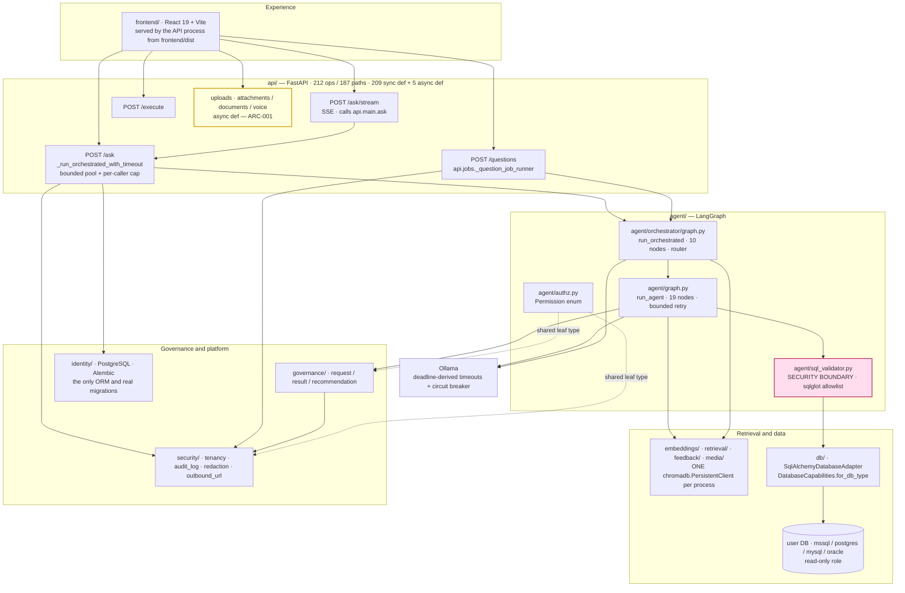

# Phase 1 — Architecture audit

**Date:** 2026-10-25 · **Branch:** `uat-readiness/phase-1-architecture` ·
**Baseline:** [`phase-0-recon.md`](phase-0-recon.md)

> **Scope honesty.** This file covers **Phase 1 only**. Phases 2–12 are
> not started. Where a check could not run in this environment it is
> recorded as **Unverified** with the command a human must run — never as
> passed.

---

## 1. Method

Every structural claim below was produced by a tool against the code, not
by reading documentation.

| Check | How |
|---|---|
| Import graph, cycles, layer direction | AST walk over `git ls-files '*.py'` (884 files), classifying each import edge as **module-level** (runtime), **deferred** (function-local), or **type-only** (`if TYPE_CHECKING:`) |
| Blocking work on the event loop | AST walk over `api/*.py`, matching `async def` route handlers against un-awaited calls to known-blocking callees |
| Graph node inventory | AST extraction of `add_node(...)` literals from `agent/graph.py` |
| Correlation-ID handling | Live probe against the real app via `fastapi.testclient.TestClient` |

**One correction worth recording,** because it changed a conclusion: the
first run of the import-graph script counted `if TYPE_CHECKING:` imports
as runtime edges and reported **3** module-level import cycles, including
`db.connection → security.redaction → db.connection`. That edge is
type-only (`security/redaction.py:43-45`). Excluding type-only imports,
the real count is **1**. A session repeating this audit should exclude
`TYPE_CHECKING` blocks or it will report cycles that do not exist.

---

## 2. Current-state architecture



Pink = the SQL security boundary. Yellow = the one node carrying an open
Phase 1 defect (`ARC-001`).

---

## 3. What was checked, and what it showed

### 3.1 Layering, boundaries and circular imports — **passes**

| Property | Result |
|---|---|
| Runtime (import-time) module cycles | **1**, and it is `mcp_client/__init__.py` ↔ `mcp_client/client.py` — the ordinary package-init pattern, not a layering defect |
| Lower layers importing `api/` | **none** (`jobs/`, `agent/`, `db/`, `governance/` are all clean) |
| `jobs/` importing `api/` | **none at module level.** `api/jobs.py` imports `api.main` lazily *inside* the runner and documents why: `jobs/` takes an injected `JobRunner`, so the dependency runs API→jobs only |
| `agent/` importing `agent/orchestrator/` | **1**, function-local (`agent/tools/definitions.py:96`), so the orchestrator still sits above `agent/` at import time |
| Dialect branching inside `agent/` | **none** — zero matches for `db_type ==` / `== "mssql"` / `== "postgres"` anywhere under `agent/` |

**Package-level cycles: 56.** Every 2-cycle inspected resolves to the same
benign pattern — a lower package importing a **shared leaf type** that
happens to live inside a higher package:

| Edge | What is actually imported |
|---|---|
| `sources → agent` | `agent.authz.Permission` (`sources/descriptors.py:25`, `registry.py:26`, `types.py:38`) |
| `observability → agent` | `agent.state.StageTiming` (`observability/metrics.py:72`) |
| `guardrails → agent` | `agent.input_guard.check_input` (`guardrails/engine.py:25`) |
| `config → moderation` | `moderation.taxonomy.Category` (`config/moderation_blocklist.py:21`) |
| `config → security` | `security.sanitization.normalize_text` (`config/table_descriptions.py:25`) |

These are not inversions of control and they create no runtime cycle.
Recorded as `ARC-005` (S4) only because the package graph is harder to
reason about than it needs to be; moving `Permission`, `StageTiming` and
`Category` into a leaf package would remove most of the 56. **No change
made** — it would touch many files for no behavioural gain.

`config/settings.py` additionally imports `agent`, `mcp_client`,
`model_routing` and `security` from **inside validator functions**
(`:276`, `:278`, `:3916`, `:4456`). Deferred, so `config` stays importable
on its own; noted because it is the lowest layer and the deferral is what
keeps it so.

### 3.2 One pipeline, not two — **passes**

`run_orchestrated` has exactly two callers in `api/`:

- `api/main.py:1442` — `/ask`, via `_run_orchestrated_with_timeout`
- `api/jobs.py:298` — the queue's `_question_job_runner`

The job runner then reuses `api.main._ask_response_from_state` and
`api.chat_persistence.persist_ask_turn` rather than assembling its own
response, so there is no second response path where a control could be
missed. `api/streaming.py` calls `api.main.ask` itself.

It also adds a **third** re-governance surface for persisted results,
`api.jobs._regovern_job_result`, alongside `api.artifacts._result_out` and
`api.shares._governed_result_snapshot`. CLAUDE.md §5.4 still says
"**Both** read-back surfaces do this" and names only two — recorded as
`DOC-004` (S4) and **fixed** in this pass.

### 3.3 Database adapter contract — **passes, and is stronger than the contract describes**

There is **one** `DatabaseAdapter` Protocol (`db/adapter.py:213`) and
**one** implementation, `SqlAlchemyDatabaseAdapter` (`:278`), parameterised
by `DatabaseCapabilities.for_db_type()` (`:182`). There are no parallel
per-dialect adapter classes, so the "SQL Server and PostgreSQL adapters
implement the same interface" requirement cannot be violated by drift —
there is nothing to drift from.

Dialect knowledge is confined to `db/` and passed into the agent **as
data**: `agent/sql_validator.py::validate_sql(sql, dialect=...)` takes the
dialect as an argument sourced from `db.connection.get_sqlglot_dialect`.
All **7** call sites pass it explicitly:

```
agent/nodes.py:2176        api/artifacts.py:813       api/bi_integration.py:251
api/bi_integration.py:404  api/main.py:1849           onboarding/evaluation.py:85
scripts/integration_test.py:96
```

Note for Phase 2: `DEFAULT_DIALECT` is `None` (sqlglot's generic SQL), so a
*future* call site that forgets the argument would validate as generic SQL
while the server executes T-SQL. No such call site exists today. Phase 2
owns the dialect-mismatch attack class.

### 3.4 Read-only enforcement — **layered, but the second layer is off in a default UAT config**

Read-only is genuinely two-layer as claimed: the validator, plus
`db.connection.check_write_privileges` invoked from `api.main.lifespan` via
`_enforce_database_write_privileges` (`api/main.py:215`). That function is
well built — it fails **closed** in production, fails **open** when the
check itself cannot run (documented, with the reason), and logs a
`critical` security event either way.

**But its refusal is gated on `settings.environment == "production"`, and
`environment` defaults to `"development"` (`config/settings.py:3213`) —
which is also what `.env.example:619` ships.** Exactly three controls are
gated this way, and all three therefore degrade on a host built from
`.env.example`:

| Control | Location | Behaviour outside production |
|---|---|---|
| Refuse to start with a writable DB role | `api/main.py:269` | warning log only |
| Refuse to start with no authentication at all | `config/settings.py:4212` | starts, serving every route unauthenticated |
| Refuse to start with uploads on and malware scanning disabled | `config/settings.py:4247` | starts with no scanning |

A UAT host is precisely the deployment these exist to protect, and the
default leaves all three advisory. Recorded as **`OPS-003` (S2)** —
environment configuration, not a code defect, and the single most
consequential Phase 1 finding for UAT.

### 3.5 Multi-database routing — **the named defect is confirmed**

`embeddings/retriever.py::select_database` (`:599`) scores each configured
database by `1.0 - <Chroma distance>` of its single best-matching table's
DDL embedding (`:665-694`) and takes the max. The only emptiness check is
`collection.count() == 0` (`:672`), which skips a database whose **index**
is unbuilt — not one whose **tables are empty**.

So a schema-rich, data-empty database can and will win the route, and:

- **No data-presence signal is consulted.** One already exists —
  `TableSchemaInfo.row_count_estimate` (`db/schema_introspection.py:125`,
  catalog-only and cheap) — but it is **opt-in**
  (`include_row_counts=False`) and its only consumers are
  `onboarding/jobs.py:107` and `schema_drift/snapshot_store.py:88`.
  Neither `embeddings/schema_indexer.py` nor `embeddings/retriever.py`
  reads it, so the index does not carry row counts and routing cannot see
  them. This is CLAUDE.md §1's "built, not wired" category.
- **The user cannot override it.** `AskRequest` has no `database` field —
  its fields are `question, conversation_history, enable_insight,
  session_id, conversation_id, attachment_ids, model, forecast_horizon,
  sources`. `AskResponse.database` is output only ("was auto-routed to").
  `ExecuteRequest` *does* take `database`, but that is after SQL exists.

**Flagged, not fixed** (`ARC-002`, S2) — both candidate fixes change a
product decision, which Shared Rule 8 reserves for the owner. §5 has the
two proposals.

### 3.5a Tenant partitioning per persistence layer — **a gap, S1-class and latent**

`docs/MULTI_TENANCY.md` §3 carries a partition table listing 17 scoped
surfaces, and §5 lists 7 known limitations. It is a genuinely good
document, and most of what it claims checks out: attachments are keyed by
**caller identity** rather than tenant and §5.6 says so explicitly (sound
— a caller belongs to exactly one tenant), and business-context retrieval
is partitioned in `retrieval.retriever._chunk_tenant_id` rather than in
`retrieval/vector_store.py`, which is why that file shows no tenant
references.

**Three surfaces are in neither the partition table nor the limitations
list, and are not partitioned at any layer:**

| Surface | Store | Routes | Default |
|---|---|---|---|
| Document RAG | `rag/store.py` — **0** tenant references | `api/documents.py` — **0** | `enable_document_rag=False` |
| Policy RAG | same store | same | `enable_policy_rag=False` |
| Media library / search | `media/store.py` — **0** | `api/media.py`, `api/media_search.py`, `api/media_library.py` — **0** each | `enable_media_search=`**`True`** |

Evidence for documents specifically:

- `rag/store.py:84-120` — `DocumentRecord` and `ChunkMatch` have no
  `tenant_id` field. Scoping fields are `collection`,
  `sensitivity_category`, `uploaded_by` and `restricted_roles`.
- No store function accepts a tenant: `list_documents(engine, collection)`
  (`:390`), `similarity_search(...)` (`:502`),
  `get_document_bytes(engine, document_id)` (`:476`),
  `delete_document(engine, document_id)` (`:494`).
- `api/documents.py` contains the string "tenant" **zero** times. All four
  routes guard on a base role only —
  `require_permission(Permission.DOCUMENTS_READ|WRITE|DELETE)` at `:55`,
  `:104`, `:172`, `:194`.

So in a deployment with two real tenants, a caller in tenant B holding
`DOCUMENTS_READ` can list and download tenant A's documents, and with
`DOCUMENTS_DELETE` can delete them. By the rubric that is **S1
(cross-tenant access)**.

**Why it is recorded as latent, and not as a live S1.** Two things
currently stand between this and exploitability, and both are documented
by `docs/MULTI_TENANCY.md` itself:

- §5.3 — "**No self-service tenant assignment.** All four `create_user`
  call sites leave `tenant_id` at its default, so a non-default tenant can
  only be assigned by an operator running code against the identity
  database." So today **every user is in tenant `default`**, and there is
  no second tenant to cross.
- §5.2 — tenant isolation means nothing under `AUTH_MODE=none` or
  `static_token` anyway.

The risk is therefore: **the moment an operator uses multi-tenancy as the
document describes, documents, policies and media silently stop being
isolated** — while the partition table reads as though every persistence
layer is covered. Media search is the sharpest case because it is **on by
default**, and Phase 0 recorded this environment running with document
RAG, policy RAG and media search all enabled.

**Not fixed here.** Adding `tenant_id` to `rag.documents` is a schema
change to a non-Alembic raw-SQL store plus a change to four route
contracts — squarely what Shared Rule 8 reserves for an owner. Recorded
as **`AUZ-002` (S1, Flagged)**.

**Runtime proof is owed by Phase 4**, which is the phase that builds two
real tenants and an IDOR matrix. This finding is structural (store and
route signatures) and is explicitly **not** a runtime reproduction. The
minimum Phase 4 must do: hand-assign `tenant_id` on two users in the
identity DB, upload a document as each, and attempt cross-tenant
`GET /documents`, `GET /documents/{id}/download` and
`DELETE /documents/{id}`.

### 3.6 Concurrency and shared state — **one real race, fixed**

`api.main.lifespan` pre-warms the DB engines, the Ollama client and both
compiled graphs — but **not** the Chroma client. `_cached_chroma_client`
relied on `functools.cache` alone, which runs the wrapped function on
*every* cold-cache miss, so two threads arriving together each built a
`chromadb.PersistentClient` against the same directory.

That is the exact condition the function's own docstring records as
corrupting Chroma's HNSW segment reader, whose symptom — because
`select_database` deliberately swallows per-database query failures — is
**silent misrouting to the wrong database**, not an error anyone sees.

Reachable: `select_database` (`:665`) and `retrieve_relevant_schema`
(`:735`) both call it from `api.main._get_ask_executor`'s thread pool.

**Reproduced** before the fix — 8 threads, one directory, **8** clients
constructed and 8 distinct instances handed out. **Fixed** in `defb07a`;
`tests/test_chroma_client_singleton_concurrency.py` (5 tests) pins it,
including a non-vacuity test that drives the unlocked builder and shows it
still duplicates.

Other shared state checked and found sound: 11 first-party
`@cache`/`@lru_cache` singletons, all documented; `_cached_engine`
(`db/connection.py:192`) is deliberately unbounded with a written
justification; `tests/conftest.py` clears the process-lifetime caches
between tests. CLAUDE.md §13's "process-local state" list is accurate.

**Async/sync correctness:** 209 route handlers are plain `def` (so FastAPI
runs them in its threadpool — correct for blocking work) and only **5** are
`async def`. No `async def` handler makes an un-awaited blocking call to
the agent, the DB or Ollama. See §3.7 for the exception that does matter.

### 3.7 Blocking work on the event loop — **real, flagged**

Three `async def` handlers do heavy synchronous work after their `await`,
and `run_in_threadpool` appears **nowhere** in `api/`:

| Handler | Blocking call | What runs on the event loop |
|---|---|---|
| `api/attachments.py:70` | `:121` `validate_and_store_upload` | malware scan, PDF parse, OCR, image resize |
| `api/documents.py:91` | `:142` `ingest_pdf` | extract → chunk → **moderate** → **embed** → store |
| `api/voice.py:50` | `:77` `transcribe`, `:88` `correct_transcript` | ASR, then an **LLM call** |

All three callees are plain `def` (`attachments/pipeline.py:212`,
`rag/ingestion.py:340`, `voice/stt.py:126`, `voice/correction.py:58`).

Blast radius is the **whole deployment**, because `Dockerfile:106` runs
`uvicorn` with no `--workers`: one event loop. While a document ingests,
the worker serves nothing else — including `/ask/stream`'s SSE progress
(the feature that exists so ~80s answers do not look frozen) and
`/questions/{id}` polling.

**Flagged, not fixed** (`ARC-001`, S3). See §5 for the proposal and why it
is not applied here.

### 3.8 Failure handling — **passes**

| Dependency | Timeout | Evidence |
|---|---|---|
| Ollama | yes, **deadline-derived** | `agent/llm_client.py:51,106-117` — per-call timeouts are clamped to the request's remaining budget via `ExecutionEnvelope.timeout_for`, so independent per-call timeouts cannot compose past the request ceiling; plus a circuit breaker (`:915`) so a sustained outage stops costing every request a full timeout |
| Every outbound HTTP call | yes, all 8 | `bi_integration/push.py:76,110`, `media_gen/download.py:203`, `media_gen/upload.py:97`, `moderation/provider.py:118,132`, `search/web_search.py:58`, `security/outbound_url.py:246` — each passes an explicit `timeout=` |
| Target DB | yes | driver-level or forced connection abort (CLAUDE.md §5.1) |
| A misconfigured extra database | degrades, does not block startup | `api/main.py:437-447` warns per database and `/health` reports it |

### 3.9 Observability — **one defect, fixed**

Structured logging with a per-request correlation ID
(`_correlation_id_middleware`, `api/main.py:770`) and tenant stamping via
`CorrelationIdLogFilter`; per-node LangGraph timings via
`agent.state.StageTiming` into `observability.metrics`. **No result-row or
cell-value logging found** anywhere in `agent/`, `api/` or `db/` —
CLAUDE.md §5.6's claim holds.

The defect: the correlation ID was taken from the client's
`X-Correlation-ID` **verbatim**, bound for the request, stamped onto every
log record, and echoed back — routed through neither `normalize_text` nor
`truncate_for_log`, despite the latter's docstring saying every log line
carrying raw input "should route it through this first, never log it
unbounded."

Probed live against the running app; all three accepted and echoed back
verbatim:

| Probe | Observed |
|---|---|
| `x<TAB>level=CRITICAL<TAB>event=admin_login_success` | the log line read `correlation_id=x<TAB>level=CRITICAL<TAB>event=admin_login_success \| tenant_id=- \| …`, so a shipper parsing `key=value` pairs ingests **two forged fields** |
| `ESC[31mFAKE ESC[0m` | ANSI escapes written verbatim into logs an operator reads in a terminal |
| 4096 × `A` | accepted, and stamped onto **every** record for the request |

**Fixed** in `54e434a`: `security.audit_log.sanitize_correlation_id`
accepts only an opaque token (alphanumerics plus `.`/`_`/`:`/`-`, at most
128 chars — a UUID and a W3C `traceparent` both pass) and returns `None`
otherwise, so the middleware falls back to a generated id. Correlation
still works; nothing on a log line is attributable to client input.
`tests/test_correlation_id_sanitization.py` (23 tests) pins it.

Recorded as `ARC-004` (S3) — an audit-trail **integrity** defect, not a
privilege boundary.

### 3.10 Deployability — **passes, with one unverifiable risk the Dockerfile discloses itself**

| Property | Result |
|---|---|
| Base images pinned | **by digest**, both stages (`node:22-slim@sha256:…`, `python:3.11-slim@sha256:…`), with a comment explaining digest-over-tag |
| CI parity | base is `python:3.11-slim`, matching CI's `python-version: "3.11"` |
| Non-root | yes — `groupadd`/`useradd app` (uid 1000) at `:65`, `USER app` at `:97`, `chown -R app:app /app` at `:95` |
| Healthcheck | yes — `:99-100`, `curl -f http://localhost:8000/health` |
| Minimal layers | multi-stage; `build-essential` installed and purged **in the same `RUN`**, with a comment recording that an earlier version of that comment claimed a purge the file never performed |
| Workers | `CMD` has **no `--workers`** → single worker (see §3.7) |

**Unverified — a human must run this.** The Dockerfile states in its own
comment that "the pinned driver versions in requirements.txt were chosen
for 3.14 wheel availability on that dev machine and have **not** been
independently verified against 3.11 here." This machine has no Docker
daemon (Phase 0 §6), so dependency resolvability on 3.11 remains
**unverified**, and it is the stated residual risk for the deploy target:

```
docker build -t text-to-sql-dashboard:latest .
docker run --rm text-to-sql-dashboard:latest \
  python -c "import scipy, pyodbc, chromadb, langgraph; print('ok')"
```

Recorded as `OPS-004` (S3, Unverified). Related: `HEALTHCHECK` depends on
`GET /health`, which is Phase 0's `SEC-001` — any fix that puts `/health`
behind auth must keep an unauthenticated liveness path, or the container
healthcheck fails.

### 3.11 Performance claims — **partially re-verified**

| Claim | Source | Measured 2026-10-25 |
|---|---|---|
| `agent/graph.py` is 19 nodes | CLAUDE.md §4.1 | **19** — confirmed by AST |
| `POST /ask/stream` reuses the `/ask` handler rather than reimplementing it | CLAUDE.md §2 | confirmed — `api/streaming.py` calls `api.main.ask` |
| "12-node SQL graph" | `02_TARGET_ARCHITECTURE.md` §1 | **stale** — see §4 |

The 19 nodes, in graph order: `sanitize_input`, `classify_followup`,
`retrieve_schema`, `retrieve_golden_examples`, `retrieve_business_context`,
`classify_analytical_intent`, `build_analytical_plan`, `plan_query`,
`generate_sql`, `review_sql`, `review_metric_conformance`,
`enforce_display_names`, `validate_sql`, `estimate_cost`, `execute_sql`,
`compute_analytics`, `generate_forecast`, `generate_recommendations`,
`generate_insight`. Nine `add_conditional_edges` calls — Phase 6 owns
their bounds.

**Not re-verified:** `docs/PERFORMANCE.md`'s latency figures and the
`prompt_tokens/185 + generated/9.6` model. Measuring them needs real
Ollama runs at roughly 80s per question; this session did not run them, so
those numbers stand as previously measured and **unverified today**.
Phase 7 owns prompt-token measurement; Phase 11 owns load.

---

## 4. Deviations from `02_TARGET_ARCHITECTURE.md`

The contract is a **dated record** of the repository as of Prompt 02 and
was never revised. Its *design intent* holds; three of its figures and one
of its status notes no longer do:

| `02_TARGET_ARCHITECTURE.md` says | Reality 2026-10-25 | Direction |
|---|---|---|
| §1 "`agent/graph.py` (12 nodes)" | **19** nodes | understates |
| §1 "`api/` (67 real routes)" | **212** ops / 187 paths | understates |
| §1 "`agent/orchestrator/` (router + 6 sources)" | 10 orchestrator nodes | understates |
| §4.5 "Tenant context propagation (**plumbing only, no enforcement**)" | tenant isolation **is** enforced — `security.tenancy.reject_client_tenant_override` refuses client-supplied tenant headers in every auth mode, before authentication | **understates a control that exists** |
| §2 "NOT WIRED: `analytics/`", "NOT WIRED: `recommendation/`" | partly accurate — `analytics` is wired (`compute_analytics` is node 16); `recommendation.RecommendationProvider` is still Protocol-only (CLAUDE.md §1) | mixed |

The §4.5 row is the dangerous one: a reader trusting it would conclude
tenant isolation is unenforced and might "add" it, duplicating a control
that already exists — the precise failure mode CLAUDE.md §4.8 ("one owner
per fact") exists to prevent.

**This is a systemic issue, not four typos** — and it has already
propagated: this audit's own prompt describes a "12-node LangGraph SQL
graph" in its ROLE section and again in Phase 6, copied from this
contract. **Phase 6 must map 19 nodes, not 12.**

**Fixed** rather than left as a finding: `docs/architecture/context-map.md`
§3 declared the numbered contracts authoritative with no caveat. It now
states that they are dated records — authoritative for their feature's
design and invariants but **never** for a cross-cutting count — with the
two measured examples above. The contracts themselves were **not** edited:
they are historical records, and rewriting them would destroy the audit
trail they exist to provide.

---

## 5. Flagged for an owner decision

### `ARC-001` — blocking work on the event loop (S3)

**Proposed fix.** Wrap each of the three blocking calls in
`starlette.concurrency.run_in_threadpool` (already a transitive dependency
— FastAPI uses it for the 209 sync handlers):

```python
from starlette.concurrency import run_in_threadpool

attachment, validation_result = await run_in_threadpool(
    validate_and_store_upload, filename, upload.content_type, file_bytes, settings, ...
)
```

No API contract, schema or response change.

**Why it is not applied here.** It makes these three handlers genuinely
concurrent for the first time, against four shared stores (the attachment
filesystem, Chroma, the SQL Server `VECTOR` store, the moderation DB).
Each needs a concurrent-write safety check first — Phase 11 work. The
Chroma race fixed in §3.6 is concrete evidence that this codebase does
contain latent cold-start concurrency bugs, so the caution is
evidence-based rather than theoretical: shipping this without that check
would trade a visible stall for a possible corruption.

**Interim mitigation with no code change:** document for UAT that document
ingestion stalls the app, and ask testers not to upload mid-question.
Running uvicorn with `--workers 2+` would also help, but CLAUDE.md §13
notes every rate limiter, circuit breaker and the job queue is per-worker,
and the queue's cap is *advertised to users* — so that trade needs its own
decision.

### `ARC-002` — multi-database routing has no data-presence signal and no override (S2)

Two candidate fixes; both change a product decision.

**(a) User override — add `database: str | None` to `AskRequest`.**
Additive and optional, so CLAUDE.md §6.3-compatible; validated against
`Settings.databases_for_tenant(tenant_id)` so it cannot become a
cross-tenant selector. Cost: a new API field plus frontend work to expose
it. This is the honest fix — it makes a wrong auto-route *correctable*
rather than guessing better.

**(b) Data-presence signal — index `row_count_estimate` and skip or
penalise an all-empty database.** Reuses what already exists
(`db/row_count_estimate.py`, catalog-only). Costs an embeddings rebuild
and changes routing outcomes silently, so it needs the routing benchmark
that CLAUDE.md §13 records as not existing ("routing accuracy has no
labelled-corpus measurement behind it").

**Recommendation: (a) first.** It is bounded, measurable and leaves the
user in control. (b) without a labelled corpus risks trading one silent
misroute for another.

### `OPS-003` — three fail-closed controls are inert outside production (S2)

**No code change proposed.** This is a UAT environment requirement:

1. Set `ENVIRONMENT=production` on the UAT host, **or**
2. Accept a written waiver and verify all three by hand — confirm the
   read-only grants on every `DB_USER`, confirm an auth mode is
   configured, confirm `MALWARE_SCAN_PROVIDER` is not `disabled`.

Phase 10 should add this to the deployment runbook and Phase 11 to the
UAT environment checklist. Changing the *default* of `environment` is a
product decision and is not proposed here.

---

## 6. Fixes made in this phase

| Finding | Commit | Test | Proven to fail before |
|---|---|---|---|
| `ARC-003` Chroma client race | `defb07a` | `tests/test_chroma_client_singleton_concurrency.py` (5) | yes — 8 threads produced 8 clients and 8 distinct instances |
| `ARC-004` correlation-ID injection | `54e434a` | `tests/test_correlation_id_sanitization.py` (23) | yes — the live probe echoed all three hostile values back verbatim |
| `DOC-004` + §4 dated-contract caveat | this change | n/a (doc) | n/a |

Both code fixes use real threads / the real app rather than mocks, and the
Chroma fix carries a non-vacuity test, per CLAUDE.md §7.

### 6.1 Gates re-measured after the changes

Per Shared Rule 10 — a phase is not done if it broke something another
phase relies on.

| Gate | Phase 0 baseline | After Phase 1 | Verdict |
|---|---|---|---|
| `pytest -q` | 8,297 passed / 0 failed | **8,325 passed / 0 failed**, 11 deselected (420s) | +28 = exactly the tests added here |
| `ruff check .` | 1 finding (`I001`) | **1 finding** — the same `agent/multiagent/agents.py:23:1 I001` | unchanged; `BP-002`, not mine |
| `black --check .` | clean, 1,665 files | **clean, 1,667 files** | +2 = the two new test files |
| `bandit` (same 12 packages) | 0 Low / 0 Med / 0 High, exit 0 | **0 / 0 / 0, exit 0**, 57,002 LOC | unchanged; no `# nosec` added |
| `mypy .` | 723 errors / 129 files | **7 errors across the 4 files this branch touches, all pre-existing** | see below |

**On mypy, reported honestly.** The first form of the `ARC-003` fix
forwarded `cache_clear`/`cache_info` as function attributes, which could
not be typed; `mypy .` went 723/129 → **729/131**, and all six new errors
were mine. That is why commit `40eb9f8` exists: the forwarding was
replaced with a named `clear_chroma_client_cache()` (matching the
`clear_query_store_cache` precedent `tests/conftest.py` already imports),
which removed two `# type: ignore` comments as well. A targeted
`mypy` over the four files this branch touches now reports **only the 7
pre-existing production errors** CLAUDE.md §13 documents
(`agent/sql_validator.py:882` ×2, `db/schema_introspection.py:469`,
`identity/repositories/semantic_intelligence.py:199,200,242`,
`identity/repositories/recommendation_governance.py:402`) and none in
this branch's own files.

Note that those line numbers have **drifted** from CLAUDE.md §13's
recorded ones (`sql_validator.py:839` → `:882`,
`schema_introspection.py:376` → `:469`) while remaining the same seven
findings. Not corrected here — §13 is explicit that its entries are
dated, and a Phase 8 pass that re-measures the whole file should update
them together.

---

## 7. Commands a human must run

Nothing below could run in this environment. None of it is recorded as
passing.

| Check | Command | Why blocked here |
|---|---|---|
| 3.11 dependency resolvability + image build | `docker build -t text-to-sql-dashboard:latest .` | no Docker daemon |
| Container CVE scan | `trivy image text-to-sql-dashboard:latest` | no daemon or scanner |
| Concurrent-write safety for `ARC-001`'s four stores | load test with parallel uploads and questions | Phase 11 |
| `docs/PERFORMANCE.md` latency re-measurement | `python -m scripts.run_benchmark` | needs real Ollama, roughly 80s per question |
| Read-only grants on every `DB_USER` | `python scripts\test_db_connection.py` against the UAT host | the UAT host does not exist yet |

---

## 8. Phase 1 summary

- **Open S1: 1** — `AUZ-002`: document RAG, policy RAG and media are not
  tenant-partitioned at either the store or the route layer, and are
  absent from `docs/MULTI_TENANCY.md`'s partition table *and* its
  limitations list. Latent today only because no route assigns a
  non-default tenant (that document's own §5.3), so there is no second
  tenant to cross. Flagged; runtime proof owed by Phase 4.
- **Open S2: 2** — `ARC-002` (routing has no data-presence signal or
  override) and `OPS-003` (three fail-closed controls inert outside
  production). Both flagged for an owner decision.
- **Open S3: 2** — `ARC-001` (event-loop blocking) and `OPS-004` (the 3.11
  build is unverified).
- **Fixed this session: 2 code + 1 doc** — `ARC-003`, `ARC-004`, and
  `DOC-004` with the context-map caveat.
- **Passed with evidence:** layering and import direction, single-pipeline
  reuse, the adapter contract, dialect containment, dependency timeouts,
  log hygiene, container hardening.
- **Next phase: 2 (security).** Carry forward `DEFAULT_DIALECT = None`
  (§3.3) for the dialect-mismatch attack class, and Phase 0's `SEC-001`.
