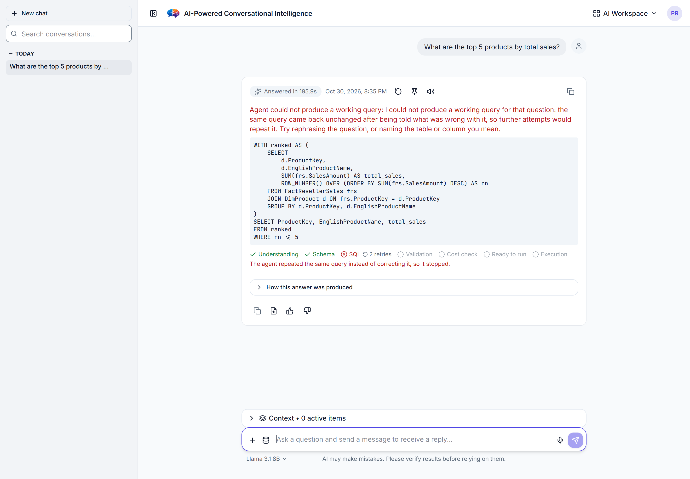

# Phase 10 — Documentation audit

**Branch:** `uat-readiness/phase-10-documentation`
**Measured:** 2026-10-30, from `9e50b6f`
**Method:** scripted diffs against the code (not reading), plus live
re-measurement of every number a document states. Four generated
artefacts underpin this report: a `Settings` ↔ `.env.example` ↔
`docs/CONFIGURATION.md` triple diff, a `docs/API.md` ↔ `app.openapi()`
endpoint diff, a Pydantic-model field-coverage diff, and a relative-link
resolver over every tracked `.md` file.

> **A documentation audit is the one phase where the method matters more
> than the reading.** Every finding below came from a script comparing a
> document to the code; not one came from noticing something looked
> wrong. Where a number was stated, it was re-run — which is how
> `MAX_QUESTION_LENGTH` turned out to be documented at a tenth of its
> real value, and how `docs/API.md` turned out never to name the field
> that carries the answer.

---

## 1. Scope and what was actually checked

| Audit item (from the prompt) | How it was checked | Outcome |
|---|---|---|
| Claims in `README.md`, `USER_GUIDE.md`, `SECURITY.md`, `CLAUDE.md`, `docs/*.md`, the numbered contracts | §2 claim table, 41 claims | 9 findings, 8 fixed |
| Commands run as written | 449 command lines extracted from 10 user-facing docs, every script/target/config they name resolved against the repo | **0 broken** |
| Env vars exist with stated defaults | 447 `Settings` fields diffed against both surfaces, defaults compared | **`DOC-013`, `DOC-014`** |
| Endpoints and response shapes match `api/schemas.py` | live `app.openapi()` (187 paths / 212 operations) + field-by-field model diff | **`DOC-020`, `DOC-021`** |
| Feature status accurate | status claims in README re-measured against the findings register and live gates | **`DOC-017`** |
| `docs/API.md` vs `/openapi.json` — generate a diff | §4, full diff; the index is now committed into `docs/API.md` | 130 undocumented, **0 phantom** |
| `docs/CONFIGURATION.md` vs `.env.example` vs `Settings` | §3 | 110 → 77 undocumented, pinned |
| UAT docs usable by a non-developer | §5, against the prompt's seven-item list | 2 items were **absent**, both added |
| Operational docs | §6, against the prompt's six-item list | 1 item was **absent** (`DOC-015`), added |
| Stale numbers, broken links, screenshots | §7 | 14 stale numbers; **0 broken links**; screenshot §7.3 |

### 1.1 What this phase did **not** check

- **External HTTP links were not fetched.** 864 relative links resolve;
  the `https://` ones were not requested, because doing so from this
  environment would be a network side effect against third parties for
  a link-rot check. A human can run a link checker against the rendered
  docs. Recorded as **UNVERIFIED**, not as passed.
- **Rendered appearance.** Markdown tables and anchors were not
  rendered in a browser. Anchor *targets* within this repository were
  not resolved either — only file paths were.
- **The 46 numbered contracts were not line-audited.** This is
  deliberate and §2.6 explains why: the project already has a written,
  correct policy for their staleness and it is being followed.
- **`USER_GUIDE.md` was not rewritten.** §2.5 records why that is a
  flagged decision and not an omission.

---

## 2. Claim-verification table

Claim → location → verified? → fix. "Verified" means re-measured on
2026-10-30 by the command in the Evidence column, not read and believed.

### 2.1 Status and measurement claims

| # | Claim | Location | Verified? | Evidence | Fix |
|---|---|---|---|---|---|
| 1 | "A first-pass readiness audit … has completed reconnaissance only" and found "one open information-disclosure item" | `README.md` intro | **NO** — phases 0–9 were complete; **1 open S1** and 8 flagged S2s | `docs/uat-readiness/FINDINGS_REGISTER.md`, 10 phase files | `DOC-017`, fixed `9e5a8e1` |
| 2 | "one blocking gate red — a single `ruff` import-order finding" | `README.md` ×2 | **NO** | `ruff check .` → `All checks passed!`, exit **0** | `DOC-017`, fixed |
| 3 | "`pip-audit` still could not be re-measured here … no egress" | `README.md` | **NO** — it ran | `pip-audit -r requirements-dev.txt --desc --ignore-vuln …` (CI's exact 6 IDs) → **"No known vulnerabilities found, 7 ignored"**, exit 0 | `DOC-017`, fixed |
| 4 | "8,297 backend passed / 0 failed" | `README.md` | **NO** — stale | `pytest -q` → **9,593 passed, 16 skipped, 11 deselected, 8 xfailed, 0 failed**, 625.95s | `DOC-017`, fixed |
| 5 | "1,491 frontend across 103 files" | `README.md` | **NO** — stale | `npm run test` → **107 files / 1,551 tests**, 0 failed, 35.08s | `DOC-017`, fixed |
| 6 | "`bandit` … 0 Low/0 Med/0 High across **56,950** lines" | `README.md` | **Partly** — still 0 findings, but the line count understated scope by half | `bandit -c pyproject.toml -r .` → 0 findings over **119,480** lines. Phase 8 rescoped it from 12 named packages to the whole tree | `DOC-017`, fixed |
| 7 | "`black` clean over 1,665 files" | `README.md` | **NO** — stale | `black --check .` → exit 0, **1,686** files | `DOC-017`, fixed |
| 8 | "the 15-journey, 6-role script" | `README.md` ×2 | **NO** | `UAT_SCRIPTS_AND_SIGNOFF.md` defines **J1–J18** and says "18 journeys across 6 roles" in its own header | `DOC-012`/`DOC-017`, fixed |
| 9 | "7,274 backend and 1,161 frontend tests passing" | `UAT_SCRIPTS_AND_SIGNOFF.md` §header, §2.6 | **NO** — two measurements stale | as #4/#5 | `DOC-018`, fixed `9f7f0df` |
| 10 | "92.3% execution accuracy … `llama3.1:8b` … 57 cases", with a staleness banner | `README.md` Known limitations | **YES** | `docs/EVALUATION.md:53-64` states exactly those figures, that model, that database, 57 cases, and self-discloses as stale | none needed; newer `HAL-007` evidence added alongside |
| 11 | `docs/EVALUATION_CURRENT.md`'s model is not the current default | the audit prompt's own premise, and `DOC-003` | **The premise is wrong** | `Settings.ollama_model` default, `.env` and `.env.example` all read `llama3.1:8b`, which is what the benchmark used, and it **is** installed (`/api/tags`) | `DOC-003` can be closed on the model question; the *staleness* half still stands |

### 2.2 Configuration claims

| # | Claim | Location | Verified? | Evidence | Fix |
|---|---|---|---|---|---|
| 12 | "Every environment variable this project reads, in one browsable table" | `docs/CONFIGURATION.md:3` | **NO** | 447 `Settings` fields; **205** absent from that file, **115** from `.env.example`, **110 from both** | `DOC-013`, fixed `501747f` |
| 13 | `MAX_QUESTION_LENGTH` default is `500` | `docs/CONFIGURATION.md` | **NO** — out by 10× | `Settings.max_question_length == 5000`; `.env.example:286` also says `5000` | `DOC-014`, fixed |
| 14 | `.env.example` is the source of truth for defaults | `docs/CONFIGURATION.md:4` | **YES, where a variable is present** | 291 active + 74 commented entries compared literal-by-literal against `Settings` defaults: **0 genuine mismatches** (23 apparent ones are all formatting — `0.60` vs `0.6`, `WindowsPath(...)` vs `./path`, tuple vs comma string, or a deliberate placeholder such as `your_password` against a `None` default) | none needed |
| 15 | `OLLAMA_MODELS`, `EMBEDDING_MODEL`, `VISION_MODEL`, `MAX_TOOL_CALLS`, `MAX_TOKENS_PER_REQUEST` named in the doc but not `Settings` fields | `docs/CONFIGURATION.md` | **YES — each is deliberately labelled as not this app's** | the doc states "`OLLAMA_MODELS` is an Ollama setting, not one of this app's", and maps the other four to their real field names | none needed |
| 16 | 26 `ENABLE_*` flags gate real behaviour and are an operator's rollback lever | `docs/DEPLOYMENT.md` rollback §, implicitly | **The lever existed; the flags were undiscoverable** | all 26 absent from both surfaces | `DOC-013`, fixed |

### 2.3 API and schema claims

| # | Claim | Location | Verified? | Evidence | Fix |
|---|---|---|---|---|---|
| 17 | `docs/API.md`'s "## Endpoints" covers the API | `docs/API.md` | **NO, and it never said otherwise** | 212 operations live; **82** described in prose | `DOC-020`, fixed `9f6c856` |
| 18 | Every endpoint named in `docs/API.md` exists | `docs/API.md` | **YES** | 3 apparent phantoms all resolve: `GET /live` is real with `include_in_schema=False`; `DELETE /documents` and `POST /governance/assets/{}` are prose shorthand for parameterised paths | none needed; now pinned by test |
| 19 | The `POST /ask` response example "mirrors what the dashboard renders" | `docs/API.md` | **Partly — misleading by omission** | the example shows 16 of `AskResponse`'s **53** fields, and **26 were named nowhere in the document**, `synthesized_answer` among them — the field carrying the prose answer on every non-SQL route, where the documented `insight` is `None` | `DOC-021`, fixed |
| 20 | `ExecuteResponse` is described | `docs/API.md` "Other routes" | **NO** | 6 of 14 fields unnamed, including `normalized_sql` — the statement that actually ran | `DOC-021`, fixed |
| 21 | "`POST /ask` calls `run_orchestrated` directly … every safety layer governs this endpoint identically" | `docs/API.md:12-20` | **YES** | `api/main.py`'s `ask`; the governed sequence is unchanged and Phase 2/4 verified it adversarially | none needed |
| 22 | `AskRequest` has no `database` field, so a mis-routed question cannot be redirected | `UAT_SCRIPTS_AND_SIGNOFF.md` §2.6 F-012 | **YES, still true** | `api/schemas.py:49-154` — 9 fields: `question`, `conversation_history`, `enable_insight`, `session_id`, `conversation_id`, `attachment_ids`, `model`, `forecast_horizon`, `sources` | none needed (`ARC-002` owns the defect) |

### 2.4 Security and operational claims

| # | Claim | Location | Verified? | Evidence | Fix |
|---|---|---|---|---|---|
| 23 | `check_write_privileges` is "best-effort, warning-only" and "never blocks" | `SECURITY.md:76-86` | **NO — it understated a control that exists** | `api.main._enforce_database_write_privileges` raises `ConfigurationError` when `settings.environment == "production"`; `tests/test_startup_write_privilege_enforcement.py` already pinned this | `DOC-016`, fixed `892add9` |
| 24 | …"surfaced in the UI sidebar" | same bullet | **NO** | no `write_privilege`/`has_write` reference anywhere in `frontend/src` or `api/schemas.py`; this was the removed Streamlit sidebar | `DOC-016`, fixed |
| 25 | "use a dedicated read-only database account" | `README.md`, `docs/DEPLOYMENT.md`, `SECURITY.md` (14 lines) | **The instruction is right and had no procedure anywhere** | `grep -rn "GRANT SELECT\|db_datareader\|CREATE LOGIN" --include=*.md .` → **1 hit**, unrelated | `DOC-015`, new `docs/DBA_READONLY_ACCOUNTS.md` |
| 26 | "Every one of this project's **9** migrations has a real `downgrade()`" | `docs/DEPLOYMENT.md` rollback § | **Count NO, substance YES** | `ls identity/migrations/versions/*.py` → **18**; all 18 define `downgrade()` with real operations (re-read, not assumed) | `DOC-019`, fixed |
| 27 | Chroma is a derived cache and not a backup target, but golden examples in it are not | `docs/DEPLOYMENT.md` backup § | **YES** | `embeddings/golden_examples.py` and `feedback/store.py` both persist under `CHROMA_PERSIST_DIR`; the doc already says to back that directory up separately | none needed |
| 28 | Query Store needs `VIEW DATABASE STATE`, never `VIEW SERVER STATE`/sysadmin | `SECURITY.md` | **YES** | `db/query_store.py:21-26` | none needed |
| 29 | The identity DB is "the only ORM and the only real migrations in this repo" | `CLAUDE.md` §2 | **YES** | `identity/migrations/` is the only Alembic tree | none needed |

### 2.5 `USER_GUIDE.md`

| # | Claim | Location | Verified? | Evidence | Fix |
|---|---|---|---|---|---|
| 30 | "Documentation revision: 2026-10-15. Describes the application as of commit `c0f4271`. Features added after that date will not appear here." | `USER_GUIDE.md:3-4` | **YES — it is accurate, and that is the problem** | the guide is honest about its own age and about the Streamlit-era UI descriptions; but it is the document a UAT business user is pointed at, and 15 days of UI work (Phase 9 alone fixed 9 UI defects) sit after it | **Flagged `DOC-022`** — see §8 |

**Why this is flagged rather than fixed.** Bringing `USER_GUIDE.md` to
the current UI means re-walking the dashboard section by section and
rewriting Part 1's button-level descriptions. That is a product-writing
exercise against a UI that is still changing under open S2 findings,
not a claim correction, and doing it from source reading rather than
from the screen would produce exactly the kind of plausible-but-unseen
prose this audit exists to find. The guide's own disclaimer is
currently load-bearing and should stay until someone can walk the UI.

### 2.6 The numbered contracts

| # | Claim | Location | Verified? | Evidence | Fix |
|---|---|---|---|---|---|
| 31 | "`agent/graph.py` (12 nodes)" | `02_TARGET_ARCHITECTURE.md`, `01_BASELINE…`, and four `docs/*.md` | **NO — 19** | compiled graph's node set: 19 (`sanitize_input` … `generate_recommendations`) | **No edit.** Already recorded as a known-stale figure by `docs/architecture/context-map.md` §3 |
| 32 | "`api/` (67 real routes)" | `02_TARGET_ARCHITECTURE.md` | **NO — 212 operations / 187 paths** | `app.openapi()` | same — context-map §3 already records it, **and its stated figure is exactly right** |
| 33 | Contracts are "dated records, not living documents … never authoritative for a cross-cutting count" | `docs/architecture/context-map.md` §3 | **YES, and it is the correct policy** | the policy is stated, the two live examples it gives are both accurate today | none needed |

**This is the one place the audit deliberately did not "fix stale
numbers".** 46 contracts and ~20 dated assessment reports contain
node/route/test counts that were right when written. The project has
already decided — in writing, in the document whose job is resolving
conflicts — that those figures are not authoritative and that the
living sources are `CLAUDE.md` and the reference docs. Rewriting a
dated record to carry today's number would destroy the thing that makes
it readable as history, and would have to be redone next month.
**Verified instead that the policy's own two cited examples are still
accurate**, which they are, to the digit.

### 2.7 Commands

| # | Claim | Location | Verified? | Evidence | Fix |
|---|---|---|---|---|---|
| 34 | Every documented command runs as written | 10 user-facing docs | **YES** | **449** command lines extracted from fenced blocks; every `python scripts/*.py`, `python -m …`, `.\tasks.ps1 <target>`, `make <target>`, `alembic -c <cfg>` and `npm run <script>` resolved against the repo. **0 real misses** (2 regex false positives: `python -m venv`, and the word "the" after "make" in prose) | none needed |
| 35 | `python scripts\test_db_connection.py` and `scripts\build_embeddings.py` work when run **by path** | `README.md`, `CLAUDE.md` §9 | **YES** | both insert the repo root into `sys.path` at import time (`scripts/test_db_connection.py:25`). 21 of 25 scripts do; the two documented-by-path exceptions (`check_instruction_size.py`, `check_secrets_baseline.py`) import no project module and were run to confirm | none needed |
| 36 | "Equivalent `make test` / `make lint` / `make format` targets exist" | `CLAUDE.md` §9 | **YES**, with an undocumented asymmetry | `tasks.ps1` has 12 targets, `Makefile` 12; **`make load-test` has no PowerShell equivalent** (and is cited in `docs/SCALE_BASELINE.md` four times) and **`.\tasks.ps1 try` is documented nowhere** | **Flagged `DOC-023`** (S4) |
| 37 | `.\tasks.ps1 lint` is the pre-commit gate | `CLAUDE.md` §6.2 | **YES** | `tasks.ps1` `lint` runs ruff + black + mypy | none needed |

### 2.8 Links, structure, size

| # | Claim | Location | Verified? | Evidence | Fix |
|---|---|---|---|---|---|
| 38 | Internal documentation links resolve | all 202 tracked `.md` files | **YES** | **864** relative links checked, **0 broken**. The 4 reported are illustrative markdown inside prose (`[1](url)` in `MULTI_SOURCE_GUIDE.md`, `[x](javascript:…)` in a pen-test report) | none needed |
| 39 | External `https://` links resolve | all | **UNVERIFIED** | not fetched; see §1.1 | a human must run a link checker |
| 40 | `CLAUDE.md` is within the project's own instruction-size budget | `scripts/check_instruction_size.py` | **NO** | `python scripts/check_instruction_size.py` → `CLAUDE.md 93,619 chars **over the soft target**`, exit **1**. Soft target 60,000; Claude Code's hard limit 150,000 | **Flagged `DOC-024`** (S4) — see §8 |
| 41 | `README.md`'s diagram is "a real screenshot … still TODO" | `README.md:103-104` | **YES, it was** | no chat + generated-SQL screenshot existed in the repository | §7.3 |

---

## 3. `Settings` ↔ `.env.example` ↔ `docs/CONFIGURATION.md`

**Measured 2026-10-30, before this phase's commits:**

| | Count |
|---|---|
| `Settings` fields | **447** |
| Absent from `docs/CONFIGURATION.md` | 205 |
| Absent from `.env.example` | 115 |
| **Absent from both** | **110** |
| Genuine default mismatches between `.env.example` and `Settings` | **0** |
| Documented defaults wrong against the code | **1** (`MAX_QUESTION_LENGTH`) |

The "absent from both" set is what matters: those settings were
reachable from the code and from nowhere a person reads. Twenty-six of
them are `ENABLE_*` feature flags, **most on by default**, and
`docs/DEPLOYMENT.md`'s rollback procedure tells an operator to "set the
flag back" for a misbehaving feature. Naming flags an operator cannot
find is not a rollback procedure.

**Fixed:** all 26 flags and the four `HARNESS_MAX_*` ceilings they gate,
in both surfaces, with descriptions taken from `config/settings.py`'s own
`Attributes:` docstring or the inline comment above each field. The gap
is now **77**. Every remaining entry is a numeric tuning constant for
the analytics, forecasting, root-cause, predictive, query-store,
lineage, schema-drift or data-quality engines; `DATABASES` and
`PROJECT_ROOT` are excluded as computed, not settable.

**Pinned, not just fixed.** `tests/test_configuration_doc_coverage.py`
(36 tests) holds the 77 as a **no-growth baseline** that fails in both
directions — a new undocumented setting fails, and a baseline entry that
has since been documented fails too, so the list cannot decay into an
allowlist. It also asserts all 30 documented defaults against
`Settings`. Mutation-verified: removing one flag reference from either
surface fails 2 of the 36.

**One observation for a later pass, not raised as a finding:** 108 of
the 447 fields have no entry in `Settings`' `Attributes:` docstring
either. That is a code-documentation gap (`CLAUDE.md` §6.2), not a
documentation-audit one, and it is why the 77 could not be
auto-documented without inventing descriptions — which this audit will
not do.

---

## 4. `docs/API.md` ↔ `/openapi.json`

Generated from `app.openapi()` with no server running.

| | Count |
|---|---|
| Paths | **187** |
| Operations in the schema | **212** |
| Addressable API operations (adding `GET /live`) | **213** |
| `APIRoute` objects (adding the SPA catch-all) | **214** |
| Described in `docs/API.md` prose | **82** |
| In code, no section in the document | **130** |
| **In the document, not in code** | **0** |

The 213 figure reconciles with Phase 6's "all 213 operations deny an
anonymous caller": that count includes `/live` and excludes
`GET /{full_path:path}`, which serves `frontend/dist` rather than being
an API operation. `docs/architecture/context-map.md`'s "212 operations
/ 187 paths" is **exactly right**.

Zero phantom endpoints is the good result here — nothing in the
document points a caller at a route that does not exist. The real
defect was silence: a reader could not distinguish "this page does not
cover it" from "it does not exist".

**Fixed:** a coverage statement at the head of `## Endpoints`, and a
generated **Full endpoint index** listing all 212 with a per-operation
"described above?" column. `tests/test_api_doc_schema_coverage.py`
asserts the index's own path/operation counts against the live schema,
so it cannot rot unnoticed.

### 4.1 The response-shape diff is the finding that would break a client

| Model | Fields | Unnamed in `docs/API.md` (before) |
|---|---|---|
| `AskRequest` | 9 | 3 |
| **`AskResponse`** | **53** | **26** |
| `ExecuteRequest` | 4 | 2 |
| `ExecuteResponse` | 14 | 6 |

`synthesized_answer` was among the 26. It carries the prose answer
whenever two or more sources contributed **and on the router's
no-retrieval route** — a general-knowledge reply, or the fixed
"I couldn't match that to a data source" message. The documented
`insight` is the SQL path's one-sentence summary and is `None` there.
A client written from this page alone renders a web, document, policy or
no-match answer as **blank**, which looks like a server fault and is
not one.

All four models are now at **0 unnamed fields**, and
`tests/test_api_doc_schema_coverage.py` pins them field-by-field.
`api/schemas.py`'s response models are frozen and widely consumed, so a
new field is additive (`CLAUDE.md` §6.3) — which is precisely how one
reaches production undocumented.

---

## 5. UAT documentation, against the prompt's checklist

| Required | Present before? | Where | Action |
|---|---|---|---|
| UAT test plan | **Partly** | `UAT_SCRIPTS_AND_SIGNOFF.md` §1–§2 covers approach, roles and the data rule; there is no separate plan document | left as is — one document a tester reads top to bottom is better than two |
| The journey script, clear steps and expected results per role | **Yes** | §3, J1–J18, with per-step expected results and a role→journey map | counts corrected |
| Test-data description | **Yes, and good** | §2.5 gives business scenario, objective, preconditions and test data **per journey** | none |
| Environment URLs / accounts process, **no real passwords** | **Half** | an Environment table to fill in, and "one account per role R1–R6, created in advance by an admin" — **with no mapping to the product's eight real roles and no procedure** | **new §2.1** |
| Defect-logging process | **Yes** | §4, with a P0–P3 rubric and "any P0 stops UAT" | none |
| **Entry criteria** | **ABSENT** | — | **new §2.2**, 9 criteria |
| **Exit criteria** | **ABSENT** | — | **new §2.3**, 8 criteria |
| Sign-off sheet | **Yes** | §5 per role, §6 overall | none |

### 5.1 The account-provisioning gap was the sharpest one

§2.5 asks for "one account per role R1–R6". R1–R6 are *business* roles.
The product seeds **eight** roles (`identity.rbac.SEED_ROLES`: `viewer`,
`user`, `analyst`, `admin`, `auditor`, `manager`, `support`,
`platform_admin`) and there is **no `tenant_admin` and no `sme`** among
them. A UAT operator following the document would have had to guess the
mapping at step one.

New §2.1 states it, gives the provisioning steps
(`alembic upgrade head` → `scripts/bootstrap_admin.py` → create five
accounts → `POST /tenant-admin/users/{user_id}/roles`), states the
credential rule (record *where* a credential came from, never the
credential), and warns that R1's `platform_admin` grants **nothing** on
`agent.authz`-gated routes including `POST /ask` — `AUZ-004`, already
on record and fail-closed — so that is not raised as a new defect at
step one.

### 5.2 §2.6 was frozen before the whole readiness audit

The "already known broken — do not raise these as new defects" table
was last touched 2026-10-17. A tester following it would have spent UAT
time rediscovering an open **S1**. Eleven current findings are now
listed with the journeys they touch and what *would* make each worth
raising anyway, and `FINDINGS_REGISTER.md` is named as authoritative so
this copy cannot quietly become the source of truth.

The most important of those for a tester is `HAL-007`, and it is worth
restating here: the system is not refusing those questions, it is
**answering a different one**. "Most popular products" returned the ten
most *expensive* products; one phrasing returned 334 rows from a ranking
that ranks nothing and another returned **0**, which a reader cannot
tell apart from "no data". No grounding gate can catch that — a
grounding gate verifies an answer against its *result*, never the
result against the *question*.

---

## 6. Operational documentation, against the prompt's checklist

| Required | Present? | Where |
|---|---|---|
| Deployment runbook | **Yes** | `docs/DEPLOYMENT.md` (535 lines: quick start, external DB, persistent vectors, health checks, reverse proxy, streaming behind a proxy, horizontal scaling, production secrets, reproducible builds) |
| Rollback procedure | **Yes** | `docs/DEPLOYMENT.md` §Rollback — image tag, `alembic downgrade`, and the feature-flag path. **Migration count corrected 9 → 18** |
| Backup/restore for the identity DB | **Yes** | `docs/DEPLOYMENT.md` §Backup & recovery — `pg_dump`/`pg_restore` plus "confirm `alembic current` reports the expected head before letting traffic back in" |
| Backup/restore for ChromaDB | **Yes, with the right nuance** | explicitly *not* a restore target (derived cache, rebuilt by `build_embeddings.py`), **but** golden examples and message feedback live in the same directory and have no live source, so a filesystem backup is called for. Correct and non-obvious |
| Incident / on-call notes | **Yes** | `docs/security/INCIDENT_RESPONSE.md`; RPO/RTO proposed in `docs/certification/RPO_RTO_PROPOSAL.md` (proposed, **not drilled** — the register's `OPS-004`) |
| Known limitations | **Yes** | `README.md` §Known limitations, `CLAUDE.md` §13, each contract's own section |
| **DBA guide for read-only accounts (SQL Server + Postgres)** | **ABSENT** | — |

### 6.1 `DOC-015` — the instruction with no procedure

Eleven documents instruct an operator to use a read-only account.
`SECURITY.md` does it on fourteen separate lines. Nothing anywhere said
what to grant. `grep -rn "GRANT SELECT\|db_datareader\|CREATE LOGIN\|REVOKE" --include=*.md .`
returned **one** hit, in an unrelated context.

New `docs/DBA_READONLY_ACCOUNTS.md`, written from the code rather than
from general knowledge. Three things in it a DBA would otherwise get
wrong:

- **The application reads the system catalog and the user's questions
  may not.** `db/schema_introspection.py` builds the entire prompt
  schema from SQLAlchemy's `Inspector`, which reads
  `INFORMATION_SCHEMA`/the catalog — while `agent/sql_validator.py`
  refuses any *generated* statement that touches those. Closing catalog
  access at the role level breaks introspection and protects nothing
  that is not already refused.
- **`db/value_sampling.py` puts real column values into the prompt** at
  index-build time, which is a reason to scope `SELECT` to the intended
  schema rather than granting it database-wide.
- **Oracle's `EXPLAIN PLAN FOR` writes to `PLAN_TABLE`**, which on a
  modern instance is a session-private global temporary table whose
  insert privilege is already held by `PUBLIC` — so it does not
  contradict a read-only role.

MySQL and Oracle recipes are included and **labelled as unverified
against a live instance**, matching `db/connection.py`'s own admission
about its privilege-check queries for those two engines.

---

## 7. Stale numbers, links and screenshots

### 7.1 Numbers re-measured on 2026-10-30

| Figure | Documented | Measured | Command |
|---|---|---|---|
| Backend tests | 8,297 / 7,274 | **9,593 passed, 0 failed** (16 skipped, 11 deselected, 8 xfailed, 626s) | `pytest -q` |
| Frontend tests | 1,491 / 1,435 / 1,161 | **1,551 passed, 0 failed**, 107 files | `npm run test` |
| `black` | 1,665 / 1,635 files | **1,686**, exit 0 | `black --check .` |
| `ruff` | 1 finding (`I001`) | **0**, exit 0 | `ruff check .` |
| `bandit` | 0 over 56,950 lines | **0 over 119,480 lines** | `bandit -c pyproject.toml -r .` |
| `pip-audit` | "cannot be run here" | **exit 0**, "No known vulnerabilities found, 7 ignored" | CI's exact command |
| `npm audit --omit=dev` | 0 | **0** | `npm audit --omit=dev` |
| SQL graph nodes | 12 (contracts) | **19** | compiled graph node set |
| Orchestrator nodes | 8 (one assessment) | **10** | compiled graph node set |
| API operations | 67 (contract) | **212** schema / 213 addressable | `app.openapi()` |
| Identity migrations | 9 | **18**, all with a real `downgrade()` | `ls identity/migrations/versions/*.py` |
| UAT journeys | 15 | **18** (J1–J18) | the script's own headings |
| `Settings` fields | — | **447** | `Settings.model_fields` |
| `MAX_QUESTION_LENGTH` | 500 | **5000** | `Settings.max_question_length` |

### 7.2 Links

864 relative links across 202 tracked markdown files, **0 broken**.
External links were not fetched (§1.1).

### 7.3 The README screenshot

See §9 for what was captured and how.

---

## 8. Flagged for an owner — not fixed

| ID | Sev | What | Why not fixed here |
|---|---|---|---|
| `DOC-022` | S3 | `USER_GUIDE.md` is pinned at 2026-10-15/`c0f4271` and openly says its UI descriptions may not match. It is the document UAT business users are pointed at, and Phase 9 alone changed nine UI behaviours after that date | Rewriting Part 1 is a product-writing exercise against a UI still changing under open S2s, and doing it from source reading would produce exactly the plausible-but-unseen prose this audit exists to catch. Its disclaimer is currently load-bearing |
| `DOC-023` | S4 | `make load-test` has no `tasks.ps1` equivalent on a Windows-primary project, and `.\tasks.ps1 try` is documented nowhere | Adding a PowerShell target is a code change to the task runner, not a doc fix, and `load-test` needs Docker which is not available here to verify against |
| `DOC-024` | S4 | `CLAUDE.md` is **93,619 chars** against the project's own 60,000 soft target; `scripts/check_instruction_size.py` exits 1 | Trimming it means deciding which hard-won institutional memory to drop, and §13's entries are exactly the ones that stop a session repeating a mistake. That is the owner's call, not an auditor's. The mechanical option — moving §13's dated measurements into a reference doc the context map already provides for — is proposed, not applied |
| `DOC-003` | S4 | `docs/EVALUATION_CURRENT.md`'s accuracy figures are stale | **The model half of this finding is closed**: the figures used `llama3.1:8b`, which *is* the current default and *is* installed. The staleness half stands and needs a benchmark re-run, which `CLAUDE.md` §12 makes a deliberate exercise |
| `HAL-010` | **S2** | The display-name repair loop spent a whole retry budget on a query that already carried the readable name, ending an answerable question as a hard failure (§9) | Changing what `enforce_display_names` accepts is a product decision about `docs/DISPLAY_NAMES.md`'s contract, not a documentation fix. Found here only because this phase drove the live application for a screenshot |

---

## 9. Live capture for the README screenshot, and what it caught

`README.md:103` has said for some time that "a real screenshot of the
chat + generated-SQL view is still TODO". It was captured against the
live application at `127.0.0.1:8013` with real Chrome over the DevTools
Protocol — the same method Phase 9 used — because a synthesised or
mocked image of a product screen is exactly the kind of
plausible-but-false artefact this phase exists to remove.

**The first attempt failed, and the failure is worth more than the
screenshot would have been.** The question was
*"What are the top 5 products by total sales?"* — about as ordinary as
this product gets — on the default `llama3.1:8b` against
`adventureworks`. It ended after **195.9s** and 2 retries with:

> Agent could not produce a working query: … the same query came back
> unchanged after being told what was wrong with it, so further attempts
> would repeat it.



Two things follow from it.

**`LOP-002` works, live, and its user-facing message is good.** The
no-progress detection Phase 6 added stopped the run on attempt 3 rather
than spending the last retry reproducing the same statement, the stage
rail shows exactly where it stopped (`SQL ⟳ 2 retries`, everything after
it un-started), and the explanation names the cause and suggests a next
step without leaking internals. That is the designed behaviour and this
is the first time it has been observed against a real model rather than
a stub.

**But the question it stopped was answerable, and the SQL was close to
right.** From the server log, all three attempts were rejected by the
*same* gate — `enforce_display_names` with
`error_category=key_instead_of_display_name` — and the statement the run
ended on already selects and groups by `d.EnglishProductName`:

```sql
WITH ranked AS (
  SELECT d.ProductKey, d.EnglishProductName, SUM(frs.SalesAmount) AS total_sales,
         ROW_NUMBER() OVER (ORDER BY SUM(frs.SalesAmount) DESC) AS rn
  FROM FactResellerSales frs
  JOIN DimProduct d ON frs.ProductKey = d.ProductKey
  GROUP BY d.ProductKey, d.EnglishProductName
)
SELECT ProductKey, EnglishProductName, total_sales FROM ranked WHERE rn <= 5
```

The readable name is present; `ProductKey` is *also* projected, which is
what the guard objects to. So the repair loop consumed the whole retry
budget asking for a change the model had already largely made, and a
correct-looking top-5 query was never executed. Raised as **`HAL-010`**
(S2, flagged) — it is a grounding/display-name finding, not a
documentation one, and fixing it means changing what
`enforce_display_names` accepts, which is a product decision about
`docs/DISPLAY_NAMES.md`'s contract rather than an auditor's call.

### 9.1 The screenshot that was captured

A second run, *"What were total reseller sales for each calendar
year?"*, succeeded in **76.3s** and is now
[`docs/images/dashboard-sql-review.png`](../images/dashboard-sql-review.png),
replacing the README's TODO. It shows the stage rail with every
pre-execution stage passed, **`Ready to run` reached and `Execution` not
started**, above the app's own sentence "Nothing has run for you yet.
Review the SQL below, then choose Confirm and Run." — which is the exact
claim the README's headline makes, now evidenced rather than asserted.

Two honest notes about it, because an unqualified screenshot is a claim:

- **It does not show the SQL text.** On the ready-to-run path the app
  renders the statement behind a collapsed `SQL • not run` disclosure;
  two attempts to expand it programmatically did not find the control,
  and faking an expanded state would defeat the purpose. The caption
  describes what the image shows and no more.
- **Four capture runs were needed**, and two of the three rejects are
  recorded here rather than discarded: the first is `HAL-010` above, and
  the second landed mid-way through an expanded schema-DDL panel because
  the chat auto-scrolls to the bottom — a reminder, in the same family
  as Phase 9's §3.4, that *a screenshot of a screen you did not
  deliberately position is not evidence of anything*. A third attempt
  reopened the saved conversation from the sidebar and rendered an empty
  pane; that is **not** recorded as a finding, because the driver's
  click may have landed on a non-interactive wrapper rather than the
  conversation control, and an ambiguous driver result is not a defect.
  A human should confirm J6.4 (conversation reload) by hand.

---

## 10. Exact commands a human must run

Nothing in §2 is blocked on infrastructure, but three things were not
and could not be done here:

```bash
# 1. External link rot. Not run here: it is a network side effect
#    against third parties, and a false positive rate that needs a human.
npx --yes markdown-link-check -q README.md USER_GUIDE.md SECURITY.md
#    …or a crawler over the rendered docs.

# 2. Re-run the accuracy benchmark, which is what actually closes
#    DOC-003 and gives HAL-007 a number. Needs live Ollama + the real
#    AdventureWorksDW2025. ~80s per question, 57 questions.
python -m scripts.run_benchmark

# 3. Walk the dashboard and bring USER_GUIDE.md Part 1 to the current UI
#    (DOC-022). A person at the screen, not a script.
```

---

## 11. Fixes made in this phase

| Commit | What |
|---|---|
| `501747f` | `DOC-013`/`DOC-014` — 26 undocumented engine flags + 4 harness ceilings documented in both surfaces; false completeness claim replaced with the measured gap; `MAX_QUESTION_LENGTH` corrected 500 → 5000; `tests/test_configuration_doc_coverage.py` (36 tests, mutation-verified) |
| `892add9` | `DOC-015`/`DOC-016` — new `docs/DBA_READONLY_ACCOUNTS.md`; `SECURITY.md`'s "warning-only, never blocks" corrected to the fail-closed production behaviour it has had since Phase 3, and the stale Streamlit-sidebar reference removed; indexed in `CLAUDE.md` §8 and the context map |
| `9e5a8e1` | `DOC-017` — README status block: the audit's phase count and its open **S1**, every stale gate and test figure, 15→18 journeys, a 2026-10-30 News entry, and the newer `HAL-007` accuracy evidence |
| `9f7f0df` | `DOC-018` — UAT script: new §2.1 account provisioning, §2.2 entry criteria, §2.3 exit criteria; §2.6 refreshed with the eleven current findings |
| `9f6c856` | `DOC-019`/`DOC-020`/`DOC-021` — `docs/API.md` coverage statement + generated full endpoint index; all 26 missing `AskResponse` fields and 6 `ExecuteResponse` fields documented, `synthesized_answer` foremost; `DEPLOYMENT.md` migration count 9 → 18; `tests/test_api_doc_schema_coverage.py` (7 tests, mutation-verified) |

---

## 12. Session summary

- **Open S1: 1** (`AUZ-002`, unchanged — not this phase's to fix).
- **Open S2: 9** — 8 carried in unchanged, **+1 new**: `HAL-010`, found
  incidentally while capturing the README screenshot against the live
  application (§9).
- **Fixed this session: 9 documentation findings** (`DOC-013` …
  `DOC-021`), two of them pinned by new mutation-verified test files
  (43 tests).
- **Flagged for a decision: 5** (`DOC-022` `USER_GUIDE.md` currency,
  `DOC-023` task-runner asymmetry, `DOC-024` `CLAUDE.md` over its own
  size budget, `DOC-003` narrowed to its staleness half, and `HAL-010`).
- **Next phase: 11 — Operational readiness.**
