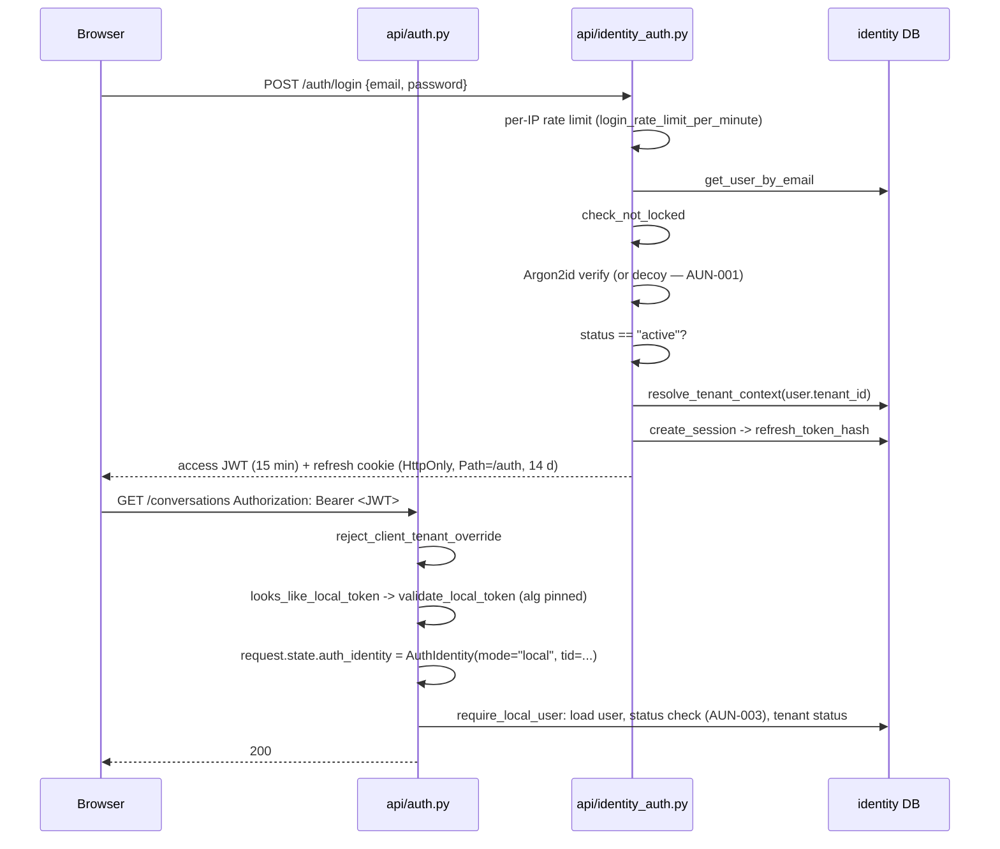
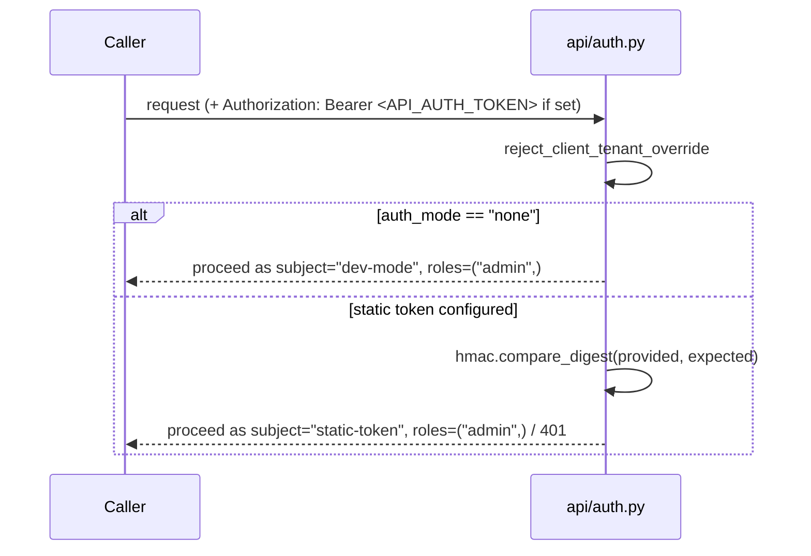

# Phase 3 — Authentication audit

**Date:** 2026-10-28 · **Branch:** `uat-readiness/phase-3-4-authn-authz` ·
**Auditor:** automated session, per `UAT_READINESS_AUDIT_PROMPT.md`

> **Scope honesty.** This file covers Phase 3 only; Phase 4 is in
> `phase-4-authorization.md`. Everything below was *measured* in this
> environment on the date shown, with the command or probe named. Where a
> check could not run here it says **UNVERIFIED** and names what a human
> must run — never "passed". OIDC against a live IdP remains blocked
> (§7).

---

## 1. What was checked

Every bullet of the prompt's Phase 3 list, against the running
application rather than against its documentation:

| Area | Method | Result |
|---|---|---|
| Auth-mode inventory | read `Settings.auth_mode` + `api/auth.py` dispatch | §2 |
| Argon2id parameters | read `identity/security.py`, confirmed library defaults | §3.1 — OK |
| Password policy server-side | 14 registrations with weak passwords | §3.2 — **1 defect** (`AUN-004`) |
| Login enumeration (body) | 4 failure modes compared byte-for-byte | §3.3 — OK |
| Login enumeration (timing) | 25 timed samples × 3 account shapes | §3.3 — **defect** (`AUN-001`) |
| Brute force / lockout | tripped the lockout, then recovered | §3.4 — **defect** (`AUN-002`) |
| JWT forgery | 15 forged tokens against `GET /auth/me` | §3.5 — OK |
| JWT secret strength | read the startup validator | §3.5 — OK |
| Session lifecycle | suspension, role revocation, tenant suspension vs. a live token | §3.6 — **defect** (`AUN-003`) |
| Refresh rotation + reuse | rotate, replay, then re-use the newest | §3.7 — OK |
| Token storage in the browser | read `frontend/src/lib`, `api/identity_auth.py` cookie flags | §3.8 — residual, documented |
| Password reset flow | single-use, expiry, generic response | §3.9 — OK |
| Email normalization / Unicode takeover | reasoned + read `normalize_email` | §3.10 — OK |
| OIDC state/nonce/PKCE | code read only | §7 — **UNVERIFIED** |
| Alembic from empty | not run (no PostgreSQL here) | §7 — **UNVERIFIED** |

Four defects found, all four fixed with tests. Findings `AUN-001`
through `AUN-004` in `FINDINGS_REGISTER.md`.

---

## 2. Auth-mode inventory

`Settings.auth_mode` reports the **highest-priority** configured
mechanism, not the only one; `api/auth.py::verify_api_key` tries local →
OIDC → static token in that order, and all four can be configured at
once.

| Mode | Trigger | Credential | Identity granted | Tenant source |
|---|---|---|---|---|
| `none` | nothing configured (**the default**) | none | `subject="dev-mode"`, roles `("admin",)` | `default` |
| `static_token` | `API_AUTH_TOKEN` set | shared bearer, `hmac.compare_digest` | `subject="static-token"`, roles `("admin",)` | `default` |
| `oidc` | `OIDC_ISSUER` set | IdP-signed JWT, validated against live JWKS | per-user, roles from the token | IdP claim, else `default` |
| `local` | `LOCAL_AUTH_ENABLED=true` | this app's own HS256/RS256/ES256 JWT | per-user, roles from `users`/`user_roles` | signature-verified `tid` claim |

Three facts worth stating plainly, because each surprises somebody:

- **The default mode grants full admin to anyone who can reach the
  port.** That is deliberate and documented, and
  `Settings._require_identity_in_production` refuses to start in
  `ENVIRONMENT=production` without identity configured. But
  `ENVIRONMENT` itself defaults to `development` — which is Phase 1's
  still-open `OPS-003`, and it is the single most important thing to get
  right in the UAT host's `.env`.
- **`static_token` is full admin with no per-user identity.** It cannot
  be scoped down, so it is a service/CI credential, not a UAT user
  credential. `POST /questions` correctly refuses it outright (CLAUDE.md
  §13).
- A client-supplied tenant header (`X-Tenant-Id` and friends) is
  **refused with 400 before authentication in every mode** —
  re-confirmed by probe.

### Sequence — `local` mode



### Sequence — `oidc` mode

```mermaid
sequenceDiagram
    participant B as Browser
    participant P as External IdP
    participant A as api/auth.py
    B->>P: authorization code flow (handled entirely client-side)
    P-->>B: id/access token
    B->>A: Authorization: Bearer <IdP JWT>
    A->>A: reject_client_tenant_override
    A->>A: looks_like_local_token -> False (iss mismatch), skip local path
    A->>P: JWKS fetch (cached per process)
    A->>A: validate_token: signature, iss, aud, exp
    A->>A: roles from the configured claim; tenant from oidc_tenant_claim
    A-->>B: 200 / 401
```

### Sequence — `static_token` / `none`



---

## 3. Findings and evidence

### 3.1 Password hashing — OK

`identity/security.py` uses `argon2.PasswordHasher()` at its library
defaults (Argon2id, OWASP-recommended time/memory cost), one
process-wide instance. `verify_password` swallows only
`VerifyMismatchError`/`InvalidHashError` and returns a bool; argon2-cffi's
own comparison is constant-time. The encoded hash carries its own
parameters, so re-tuning stays backward compatible. No password is
logged anywhere on the login path — checked by reading every
`record_signin_event` and `log_security_event` call in
`api/identity_auth.py`; they carry `user_id`, `failure_reason_code`, IP
and user-agent only.

### 3.2 `AUN-004` — the sequential-digit-run check was defeated by appending one digit

`identity/password_policy.py::_has_sequential_digit_run` promised, in its
own docstring, to flag a run of ≥6 consecutive digits "anywhere in it".
It examined each **maximal** digit group as a whole, so any digit that
broke the monotonic step disabled the check for that group:

```
'123456'               -> True      <- caught
'1234560'              -> False     <- same run, one digit appended
'123456789012'         -> False
'12345678901234567890' -> False
```

Only a run delimited by non-digits was ever caught, which is why the
docstring's own example (`"abc123456xyz"`) happened to work.
`POST /auth/register` accepted `123456789012` (**201**).

**Fixed** by checking every `min_run`-wide window inside each digit
group. Verified against 17 cases including 8 negatives (`13579`,
`918273645`, `1029384756`, `112233445566`, …) — no false positives.

*Severity S4.* A password-strength heuristic, not a boundary. Noted as a
residual: the detector is digit-only by design, so `abcdefghijkl` is
still accepted.

### 3.3 `AUN-001` — login was a fully separable account-enumeration oracle by timing

The response **body** is correct: `InvalidCredentialsError`,
`AccountLockedError` and `AccountNotActiveError` all share one
`_GENERIC_LOGIN_FAILURE` constant, and all four failure modes return
byte-identical 401s (verified by probe). The **timing** was not.

`get_user_by_email` returning `None` raised 401 immediately, with no
hashing; a Google-only account (`password_hash IS NULL`) likewise. A real
account spent a full Argon2id verification. 25 samples per group:

| Group | median | min | max |
|---|---|---|---|
| no such account | **5.94 ms** | 4.36 | 9.68 |
| exists, wrong password | **80.87 ms** | 73.49 | 111.10 |
| Google-only (no hash) | **6.73 ms** | 5.17 | 11.57 |

`min(exists) = 73.49 ms > max(absent) = 9.68 ms` — **the two sample sets
do not overlap at all.** A 13.6× ratio with a 74.9 ms absolute gap is
trivially measurable over a LAN, so an attacker could enumerate valid
accounts, and separately identify which accounts are Google-only. The
second one matters more than it looks: `api/identity_auth.py`'s own
comment states it equalized the *status code* for exactly that reason.
Equalizing the status while leaving a 12× timing gap closed the
narrower channel and left the wider one open.

**Fixed** by `identity.security.verify_password_against_decoy`: both
hash-less paths now spend one Argon2id verification against a fixed
decoy hash, so every login path performs exactly one. Re-measured:

| Group | median | min | max |
|---|---|---|---|
| no such account | 78.99 ms | 71.37 | 148.67 |
| exists, wrong password | 76.59 ms | 71.78 | 93.45 |
| Google-only (no hash) | 80.62 ms | 73.53 | 94.49 |

Ratio **1.0×**, gap **−2.4 ms**, sample sets fully overlapping. This is
not a constant-time guarantee — the ORM lookup and the sign-in-event
write still differ slightly — but the dominant term is gone.

`api.main.lifespan` now warms the decoy hash when local auth is on, so
the first unmatched login in a process doesn't pay ~150 ms instead of
~60 ms.

> **A bug this fix introduced, and the test that caught it.** The first
> version of `verify_password_against_decoy` *returned* the verification
> result. `POST /auth/login`'s Google-only branch assigns that straight
> to `password_ok`, so a caller who supplied the literal decoy string
> would have authenticated as any account with no password hash — an
> authentication bypass. `test_the_decoy_never_accepts_any_password`
> failed on the first run and the function now discards the result and
> returns `False` unconditionally. Recorded here because the lesson is
> the general one: a helper whose purpose is its cost must not also be
> read as an answer.

### 3.4 `AUN-002` — a lockout outlived a completed password reset

Lockout itself works: `max_login_attempts` (default 5, 3 in the probe)
consecutive failures set `locked_until = now + login_lockout_minutes`
(default 15), and the correct password is refused during the window with
the same generic 401.

But `identity.repositories.users.change_password` set only
`password_hash`/`password_changed_at`. It never cleared
`failed_login_count` or `locked_until`, so:

```
3 wrong guesses                                  -> account locked
POST /auth/reset-password  (valid emailed token) -> 200 "Password has been reset"
  failed_login_count=3   locked_until=<unchanged, still future>
POST /auth/login          (the brand-new password) -> 401
```

Two consequences. The documented recovery journey is **broken** — a user
does exactly what the UI tells them and still cannot sign in. And the
lockout becomes a denial-of-service primitive: anyone who knows an email
address can lock that account with 3 requests, repeatedly, and the owner
has no way to recover inside the window. The per-IP login rate limit
(10/min) does not prevent this, because the lockout counter is per
**account**.

**Fixed** in `change_password` itself rather than in the two routes, so
there is one owner for the fact — this covers both
`POST /auth/reset-password` and `POST /auth/change-password`. After:
`failed_login_count=0`, `locked_until=None`, login with the new password
**200**.

This does not weaken the lockout. Reaching `change_password` requires
either the current password or a single-use token delivered to the
account's own mailbox — both strictly stronger proofs than the password
guessing the lockout exists to slow. `record_login_success` already
cleared the same two fields for the same reason.

*Severity S2* — broken core journey, per the rubric.

### 3.5 JWT handling — OK

`validate_local_token` pins the algorithm to the configured
`Settings.jwt_algorithm` and never reads the token's own `alg` header,
requires `exp`/`iat`/`sub`/`token_type`, validates `iss` and `aud`
(PyJWT raises `MissingRequiredClaimError` when either is configured and
absent), and rejects any `token_type != "access"` so a refresh token can
never be presented as an access token. Failures raise a generic message,
never PyJWT's own text.

All 15 forgeries returned **401** against `GET /auth/me`:

| Attack | Result |
|---|---|
| unsigned `alg=none` | 401 |
| `alg` header rewritten to `none` on a genuine token | 401 |
| signature stripped from a genuine token | 401 |
| HS256 with the wrong secret | 401 |
| HS384 / HS512 with the *right* secret (algorithm substitution) | 401 |
| forged `iss` / forged `aud` | 401 |
| missing `iss` / missing `aud` | 401 |
| expired (`exp` 1 h ago) | 401 |
| `nbf` in the future | 401 |
| `token_type="refresh"` / `token_type` absent | 401 |
| valid signature, `sub` = a random UUID | 401 "Account no longer exists." |

Two cases returned 200 and are **not** findings: a token with
`roles=["platform_admin"]` or `tid="tenant-b"` and a *valid signature*.
Forging either requires the signing secret, and `/auth/me` re-reads
roles from the database regardless. They are recorded because the
underlying asymmetry matters for Phase 4 — see `phase-4-authorization.md`
§4.2.

`Settings._validate_local_auth_signing_material` refuses to start when
`LOCAL_AUTH_ENABLED=true` with an HS256 secret under 32 characters, or
with RS256/ES256 and no key paths. A floor, not a strength guarantee,
and the validator's own docstring says so.

### 3.6 `AUN-003` — a suspended account kept working until its token expired

`api.identity_authz.require_local_user` re-read the caller's **tenant**
status on every request (correctly, and CLAUDE.md §5.3 requires it) but
never the caller's own `users.status`. `POST /auth/login` and
`POST /auth/refresh` both refuse a non-`active` account, so the intent is
unambiguous — and the repository layer already refuses non-active users
as workflow owners and recommendation reviewers. Nothing enforced it per
request.

Measured with the token untouched and `status` flipped to `suspended`:

| Route | before fix | after fix |
|---|---|---|
| `GET /auth/me` | **200** | 401 |
| `GET /conversations` | **200** | 401 |
| `GET /auth/sessions` | **200** | 401 |
| `GET /navigation` | **200** | 401 |
| `GET /models` (`agent.authz`) | **200** | **200** — see below |
| `GET /sources` (`agent.authz`) | **200** | **200** — see below |
| `GET /schema/tables` (`agent.authz`) | **200** | **200** — see below |
| `POST /ask` (`agent.authz`) | **200** | **200** — see below |

**Fixed** for the 149-route `require_local_user` surface, with the same
generic 401 every other refusal there returns (a caller must not learn
"suspended" from "deleted" from "wrong tenant").

> **A correction to this audit's own first measurement.** The first pass
> at this table cited `GET /config` and `GET /schema` as the
> still-200 `agent.authz` routes. **Neither is a route.** Both fell
> through the SPA catch-all `GET /{full_path:path}` and returned
> `<!doctype html>` with status 200, which the probe scored as "allowed".
> The finding is real, but that evidence was void; it was re-taken
> against routes the live route walk confirms exist, and the replacement
> is stronger — `POST /ask` itself returns **200** for a suspended user
> and a suspended tenant, and it actually ran the question. The lesson
> generalises: on an app that serves a single-page frontend from a
> catch-all, a 200 never by itself means "this route authorized me".

The four rows that are still 200 are a **different, open finding** —
`AUZ-003`, flagged in `phase-4-authorization.md` §4.2, because the
`agent.authz` surface authorizes from the JWT alone and touches no
database. The same probe showed tenant suspension stopping at exactly
that boundary too. Fixing it is an architectural decision about where to
put a per-request database read, so it is flagged, not fixed. It is
pinned as current behaviour by
`tests/security/test_authorization_matrix.py::TestSuspensionDoesNotReachTheTokenOnlySurface`.

Role revocation behaves the same way by design: base roles travel in the
token, so a demotion takes effect on the `agent.authz` surface only when
the access token expires (≤ `access_token_expire_minutes`, default 15).
`create_access_token`'s docstring states this for *permissions*; it does
not state it for *roles*, which is the gap recorded as `DOC-008`.

### 3.7 Refresh-token rotation and reuse detection — OK

Opaque `secrets.token_urlsafe(48)`, SHA-256 at rest, never a second JWT.
Measured:

| Step | Result |
|---|---|
| `POST /auth/refresh` | 200, cookie value changed (rotated) |
| replay the already-rotated token | **401** |
| then present the legitimate newest token | **401** — the whole family is revoked |
| `POST /auth/logout` then `POST /auth/refresh` | **401** |

The third row is the one that matters and is easy to get wrong: revoking
only the replayed token would leave the attacker's stolen-but-newest
token working. A `refresh_token_reuse_detected` event is logged at
`critical`.

### 3.8 Token storage in the browser — residual, documented

The access token lives in JavaScript-reachable memory/storage; the
refresh token is an `HttpOnly` cookie scoped to `Path=/auth`, with
`Secure` from `cookie_secure` (**default `true`**; `false` only in this
test harness, which runs over plain HTTP) and `SameSite=lax` by default.
No token appears in any URL — checked across `api/` route definitions
and the frontend's request layer.

Blast radius of an XSS: the access token (≤15 min, cannot be refreshed
without the cookie, which script cannot read). That is the standard
trade-off and it is bounded in the right place.

**Residual, by design:** an access token survives `POST /auth/logout`
until it expires, because it is stateless. Measured: `GET /auth/me`
returns **200** with the pre-logout token after a successful logout,
while `POST /auth/refresh` correctly returns 401. The refresh side is
revoked server-side; the access side cannot be without a revocation list.
15 minutes is a reasonable bound, but it is **not stated in
`docs/AUTHENTICATION.md`**, which it should be — `DOC-008`.

### 3.9 Password reset and email verification — OK

High-entropy token, SHA-256 at rest, `used_at` set in the same
transaction as the redemption so a second redemption always fails,
explicit `expires_at` (default 60 min for reset, 1440 for verification).
Multiple concurrent unused reset tokens coexist deliberately, each
independently single-use. `POST /auth/forgot-password` returns the same
200 and the same generic message whether or not the email matches, and
is rate-limited per IP (5/hour).

Reset revokes **every** session for the account; `change-password`
revokes every session except the caller's own. Both are correct for
their respective threat models.

One note recorded rather than fixed: a weak-password rejection *after* a
successful redemption consumes the token's single use. The code comment
says this is a deliberate trade-off and the user can request another
link. Agreed — recorded so it isn't rediscovered as a bug.

`POST /auth/reset-password` has **no** rate limit of its own (only
`forgot-password` does). With a 48-byte CSPRNG token that is not a
practical guessing surface, and it is noted rather than raised.

### 3.10 Email normalization / Unicode takeover — OK

`EmailStr` applies email-validator's normalization (NFC local part, IDNA
domain), then `normalize_email` strips and lowercases. Registration's
duplicate check and every lookup (`login`, `forgot-password`, Google
linking) go through the *same* function, so two inputs that collapse to
one stored value cannot produce two accounts — the second registration
is a 409. That closes the usual takeover shapes, including the ones
`.lower()` creates on its own (`U+212A KELVIN SIGN` → `k`): the collision
makes a duplicate, not a second account.

---

## 4. Fixes made

| Finding | Change | Test | Mutation-verified |
|---|---|---|---|
| `AUN-001` | `identity/security.py`: `verify_password_against_decoy` + `warm_password_hasher`; both hash-less login paths call it; `api/main.py` lifespan warms it | `tests/security/test_authentication_lifecycle.py::TestLoginSpendsTheSamePasswordWorkOnEveryPath` (6) | revert → **2 fail** |
| `AUN-002` | `identity/repositories/users.py::change_password` clears `failed_login_count`/`locked_until` | `::TestAPasswordResetClearsTheLockout` (3) | revert → **2 fail** |
| `AUN-003` | `api/identity_authz.py::require_local_user` refuses a non-`active` account | `::TestANonActiveAccountLosesAccessOnItsNextRequest` (11) | revert → **10 fail** |
| `AUN-004` | `identity/password_policy.py::_has_sequential_digit_run` checks every window | `::TestPasswordPolicyIsEnforcedServerSide` (10) | revert → **3 fail** |
| `BP-003` | `tests/conftest.py` strips the open-ended `DB_*`/`MCP_*` env families, not only declared field names | `tests/test_settings_env_isolation.py` (7) | revert → **3 fail** |

Plus positive results pinned as regressions in the same file: JWT
forgery (15), refresh rotation and reuse (3), mass assignment (16),
login-failure body uniformity (1). **62 tests, all passing.**

### `BP-003` — found by accident, and worth its own paragraph

While running the Phase 4 matrix sweep, `GET /health` logged
`SAWarning: Unrecognized server version info '17.0.4025.3'` — a real SQL
Server had answered a test. `tests/conftest.py` strips every env var
whose name is a `Settings` **field** name, but `config/settings.py`
deliberately reads `DB_CONNECTIONS` + `DB_<NAME>_*` and `MCP_SERVERS` +
`MCP_<NAME>_*` straight from `os.environ`, because each names an
open-ended family no Pydantic field can declare. None of those names is a
field name, so none was ever stripped, and `load_dotenv()` had already
loaded them.

Measured with the autouse fixture active: **24 `DB_*` variables visible
inside a test**, two of them `DB_<NAME>_PASSWORD`, and
`get_settings().databases` returning this developer's four real SQL
Server connections (`hr`, `adventureworks`,
`employee_management_database`, `test_db`). So CLAUDE.md §7's "Every
pytest test is fully mocked — no real database" was false, in exactly the
way it had already been found false for Ollama: silently, with a log line
after the summary as the only trace.

Fixed by stripping the prefix families too, and pinned by a new test file
so it cannot regress unnoticed a second time. Two consequences worth
stating: suite results were machine-dependent for any test that reached
an unpatched `get_settings()`, and this is why the audit's own earlier
probes returned real table names from `hr` — those probes ran outside
`tests/`, where no conftest applies at all.

---

## 5. What remains open

| ID | Sev | Summary | Why not fixed here |
|---|---|---|---|
| `AUZ-003` | S2 | Tenant *and* account suspension do not reach the `agent.authz` surface (`/ask`, `/execute`, `/config`, `/schema`, documents, media, jobs) for up to one access-token lifetime | Needs a per-request identity-DB read in `api/auth.py` or `api/authz.py`, neither of which imports a database today. Layering + latency decision — Shared Rule 8. Detail in `phase-4-authorization.md` §4.2 |
| `DOC-008` | S3 | `docs/AUTHENTICATION.md` does not state that an access token survives logout, nor that base-role changes lag by one token lifetime on the `agent.authz` surface | Both are correct behaviour that must be *written down*; grouped into the Phase 10 documentation pass rather than edited piecemeal here |
| `OPS-003` | S2 | `ENVIRONMENT` defaults to `development`, so the "refuse to start with no authentication" control is inert | Phase 1 finding, still open; it is the highest-value single line in the UAT host's `.env` |

---

## 6. Commands a human must run

```powershell
# This phase's suites
.venv\Scripts\python.exe -m pytest tests/security/test_authentication_lifecycle.py -q
.venv\Scripts\python.exe -m pytest tests/test_api_identity_auth.py tests/test_identity_security.py `
    tests/test_identity_password_policy.py tests/test_api_auth.py tests/test_api_authz.py -q
```

---

## 7. Environment-blocked (not verified, not passed)

| Check | Why blocked here | What to run |
|---|---|---|
| **OIDC end to end** | no live IdP in this environment | Full authorization-code flow against the real IdP. Confirm `state`, `nonce` and **PKCE** are enforced, the redirect URI is an exact match, `iss`/`aud` are validated, JWKS rotation is picked up, and account linking behaves on an email that already has a local account. `security/oidc.py` validates signature/`iss`/`aud`/`exp` correctly by code reading, but the *browser-side* flow is where state/nonce/PKCE live and this app does not implement that half |
| **Alembic from empty and from the previous release** | no PostgreSQL reachable; the suite uses in-memory SQLite | `alembic -c identity\alembic.ini upgrade head` on an empty PostgreSQL database, then again from the previous release's tag. `tests/test_identity_schema_invariants.py` pins the `server_default` rule but does not run a real migration |
| **Secrets in migration files** | partially checked — `grep` over `identity/migrations/` found no credential literal — but a full-history scan belongs to the `detect-secrets` gate, which is red for an unrelated, triaged reason (`OPS-006`) | Refresh the baseline on Linux per `phase-2-security.md` §6.4, then re-run |
| **Login timing over a real network** | measured in-process via `TestClient`, which removes network jitter | Re-measure against the UAT host. In-process measurement is the *stricter* test for the fix (it isolates the server-side term); a real-network measurement is what tells you whether jitter would have masked the original 74.9 ms gap — it would not have |
| **Account lockout under real concurrency** | `record_login_failure` increments without an explicit row lock; not exercised with parallel requests here | Hammer one account from N connections and confirm the lock still trips at `max_login_attempts` rather than overshooting |

---

## 8. Session summary

- **Open S1:** 0 from this phase.
- **Open S2:** 1 from this phase (`AUZ-003`, flagged for an owner
  decision), plus Phase 1's `OPS-003`.
- **Fixed this session:** `AUN-001` (S2), `AUN-002` (S2), `AUN-003` (S2),
  `AUN-004` (S4) — each with a mutation-verified test.
- **Flagged for decision:** `AUZ-003` (where to enforce live suspension
  on the token-only surface).
- **Next phase:** Phase 4 is complete in `phase-4-authorization.md`;
  Phase 5 (hallucination and grounding) is next and needs a real Ollama
  and database.
