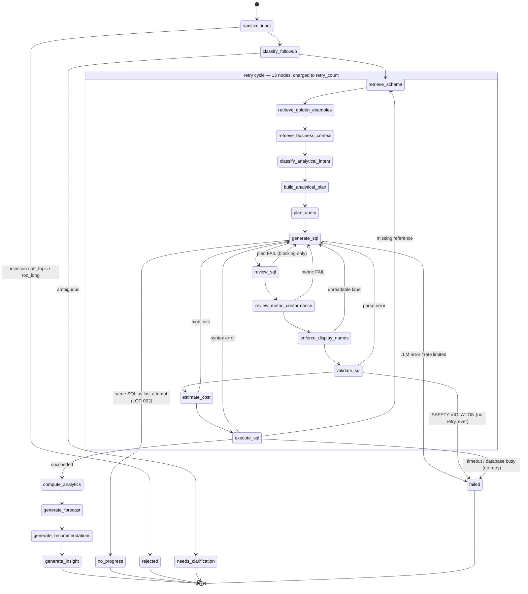

# Phase 6 — Loop engineering (agent control flow)

**Date:** 2026-10-28
**Branch:** `uat-readiness/phase-6-loops`
**Scope:** every cycle in the compiled SQL graph and the orchestrator
graph; the retry budget and its absolute ceiling; LangGraph's
`recursion_limit`; the per-request wall-clock deadline and model-call
budget; no-progress detection; whether a security gate can be retried;
the size and content of the error context fed back on a retry;
cancellation reaching the server; the job queue's own timeouts and
starvation behaviour; state growth across retries.

**Method:** the graph was driven, not read. Every claim below is either a
test in this repository, a command whose output is quoted, or a
reproduction against the real compiled graph with a stub model. Where
something could not be measured here, it says so.

---

## 1. Summary

| | Count |
|---|---|
| Findings opened | 7 |
| Fixed this phase | 7 |
| Flagged for an owner decision | 1 (the residual half of `LOP-007`) |
| Unverified | 2 (see §9) |
| New tests | 46 across 2 new files, plus 4 strengthened existing gates |

Two findings were **S2**, and both were the same shape: a *designed*
terminal condition escaping `run_agent` as an unhandled exception, so
`POST /ask` returned **HTTP 500** instead of the honest refusal the
pipeline had already composed.

- `LOP-001` — the longest retry cycle outgrew the recursion limit, so a
  question whose every attempt hit a missing column 500'd.
- `LOP-004` — `ProviderUnavailable`, raised when the Ollama circuit
  breaker opens, was caught nowhere. It fires exactly when Ollama is
  down, i.e. when graceful degradation matters most.

The rest of the control plane held up well. Every retry path increments
`retry_count` *before* routing back, every safety violation and timeout
is terminal with no retry, the job queue enforces both of its deadlines,
and the harness's budgets are real and wired. The gaps were at the
seams: the orchestrator graph, the shared Ollama helper, the SSE route,
and the one timeout nobody had clamped.

---

## 2. `LOP-001` — the worst-case retry sequence returned HTTP 500 (S2, fixed)

### What was claimed

`agent/graph.py` sized LangGraph's `recursion_limit` itself, with a
comment describing exactly this bug as already fixed:

> a worst-case retry sequence (an `execute_sql` "missing_reference"
> retry loops all the way back to `retrieve_schema` -- a 12-node cycle
> ...) can exceed 25 total steps well before `effective_max_retries` is
> exhausted. When that happened, LangGraph raised an uncaught
> `GraphRecursionError` instead of the graph reaching its own intended
> terminal "failed" state, which surfaced to callers as an unhandled 500.

The formula was `recursion_limit = 20 + effective_max_retries * 10`.

### What is true

The cycle is **13** nodes, not 12. `enforce_display_names` was inserted
into it later and neither the comment nor the arithmetic was updated;
and the multiplier, 10, was below even the figure the comment claimed.

Enumerated from the compiled graph's own edges:

```
execute_sql -> retrieve_schema -> retrieve_golden_examples
 -> retrieve_business_context -> classify_analytical_intent
 -> build_analytical_plan -> plan_query -> generate_sql -> review_sql
 -> review_metric_conformance -> enforce_display_names -> validate_sql
 -> estimate_cost -> execute_sql
```

At the default `MAX_RETRIES=3` the worst case is
`2 + 4 x 13 = 54` node executions against a limit of **50**.

### Reproduction

A stub model returning `SELECT nope FROM orders` and a stub executor
raising `UndefinedColumn` on every attempt:

```
langgraph.errors.GraphRecursionError: Recursion limit of 50 reached
without hitting a stop condition.
```

It escapes `run_agent` uncaught. `api/main.py`'s
`@app.exception_handler(Exception)` then returns **HTTP 500** with
`{"detail": "An unexpected error occurred. Please try again."}` — no
SQL, no `failure_explanation`, no attempt history, and no persisted
conversation turn, for a question the agent had in fact decided it could
not answer and had already written an explanation for.

### Fix

Two layers, because the two failure modes are different.

1. The limit is derived from three named structural constants
   (`LONGEST_RETRY_CYCLE_NODES = 13`, `PRE_CYCLE_NODES = 2`,
   `POST_EXECUTION_NODES = 4`) plus headroom, in
   `agent.graph.recursion_limit_for`. At `MAX_RETRIES=3` that is 68.
   `tests/test_agent_loop_bounds.py::TestTheStructuralBoundMatchesTheGraph`
   recomputes all three from the compiled graph's edge set by exhaustive
   cycle enumeration, so the next node added to a cycle fails a test
   that **names the new number** rather than silently shrinking the
   margin.
2. `GraphRecursionError` is now caught in `run_agent` and converted to
   the same terminal state a normally-failed run returns. This is the
   load-bearing half: the arithmetic is a number that can drift again,
   while the catch is a guarantee that drift costs a refusal rather than
   a 500. The same catch was added to `run_orchestrated`, where the
   graph is acyclic today and so it is pure insurance.

Measured after the fix: the same run executes 54 nodes and ends
`status="failed"` with a `failure_explanation`.

### Why no existing test caught it

`tests/test_full_pipeline_integration.py` had one retry test, and it
retried **once and then succeeded**. Nothing in the repository had ever
driven a cycle to its ceiling. That is the gap
`tests/test_agent_loop_bounds.py` now fills, for all four cycles.

---

## 3. `LOP-004` — an open circuit breaker was an HTTP 500 (S2, fixed)

Three related defects in one place, found by asking "which LLM calls does
the harness actually see?".

### 3.1 `rag.llm.call_ollama` bypassed the harness entirely

It built its own `ollama.Client(...)` rather than calling
`agent.llm_client.harness_ollama_client`, which is where three controls
live: the circuit-breaker check, the clamp of the per-call timeout to
the execution's remaining deadline, and `record_llm_call` — the
per-execution model-call budget.

That helper is not a corner of the codebase. Its callers are the
orchestrator's **router**, both **RAG subgraphs** (grade, rewrite,
generate), **web search**, **media search**, the **general-knowledge
answer**, and the **analyst planner**. So on a document, policy, web or
media question, `HARNESS_MAX_LLM_CALLS` counted nothing at all, and the
model calls were absent from `GET /metrics/performance` too.

It also could *open* the breaker on failure and never *close* it on
success, because it never called `log_ollama_timing` — which
`agent/llm_client.py`'s own docstring says is "strictly worse than no
breaker".

**Fixed:** `call_ollama` now uses `harness_ollama_client`, records a
failure outcome on error and calls `log_ollama_timing` on success. Both
helpers were renamed from `_harness_client`/`_log_ollama_timing` to
public names, following the precedent `decoding_options` set when it was
made public for this same module.

### 3.2 The orchestrator never bound the envelope

`call_ollama` reads the envelope from a `ContextVar`, and `/ask`'s pool
is a raw `ThreadPoolExecutor`, which does not copy `contextvars` across
`submit` — so the binding must happen on the worker side. Only
`run_agent` did it. `run_orchestrated` now binds and resets it too, so
3.1's accounting is reachable on a non-SQL route at all.

### 3.3 `ProviderUnavailable` was caught nowhere

Reproduced by tripping the breaker and calling `run_agent`:

```
RAISED agent.harness.breakers.ProviderUnavailable : Circuit open for provider 'ollama'.
```

`generate_sql_node` handles `OllamaUnavailableError` and
`MalformedLLMOutputError`; `ProviderUnavailable` is a plain
`RuntimeError` raised a layer below them, inside the client factory. A
repository-wide grep found **zero** non-test handlers.

So with the breaker open — Ollama down, every `/ask` refused without
being attempted, which is the breaker working as designed — the caller
got HTTP 500 and the generic "An unexpected error occurred" instead of
the breaker's own "The language model service is temporarily
unavailable. Please try again shortly."

**Fixed:** caught in both `run_agent` and `run_orchestrated`, converted
to a terminal `failed` state carrying `exc.safe_message` (which names no
host, model or internal error — CLAUDE.md §5.6).

### 3.4 The gate that should have caught 3.1, strengthened

`tests/test_llm_client_usage_rollup.py` already had an AST test pinning
"every `client.chat` is followed by the funnel line". It scanned
`agent/llm_client.py` **only**, and the eighth call site was in a
different module. It now scans both, and a second test asserts that
**exactly one module in the whole application constructs an
`ollama.Client`** — which is the structural claim worth pinning, since
an unmanaged client escapes all three controls rather than just the
accounting.

---

## 4. `LOP-002` — no no-progress detection (S3, fixed)

### Measured before the fix

A stub model returning one statement on every attempt, with the database
rejecting it every time:

| | Value |
|---|---|
| Generation calls (LLM) | 4 |
| Database executions | 4 |
| Distinct SQL produced | 1 |

Four model calls and four executions of a query already known to fail.
On this hardware a generation call is tens of seconds
(`docs/PERFORMANCE.md`), so the three wasted attempts are the dominant
cost of that request.

This is not a corner case. `agent.llm_client.decoding_options` sets
`temperature=0.0` for every call in this application, so an identical
prompt is *expected* to give identical output — "the model did not act on
the feedback" and "the model will never act on the feedback" are the same
event here.

### Fix

`generate_sql_node` compares the new statement against the previous
attempt's on `agent.sql_validator.canonical_sql_form` and ends the run
at `status="failed"` when they match, with
`last_error_category="no_progress"` and a fixed `NO_PROGRESS_MESSAGE`.

Three details worth recording:

- **The comparison is canonical, not textual.** sqlglot parses and
  regenerates where the statement parses, which normalizes keyword case
  and layout *without* touching string literals — so `WHERE name =
  'bob'` and `WHERE name = 'BOB'` stay different queries, which they
  are. Collapsing those would stop a run that was making progress.
  Where it does not parse (the `parse_error` retry path), it falls back
  to whitespace-collapsed upper-cased text, which still catches the
  exact repeat.
- **It compares the model's output, not `state["sql"]`.** The first
  attempt at this fix detected nothing, because `validate_sql` replaces
  `state["sql"]` with the row-limited form, so every attempt looked
  different. A new `AgentState["last_generated_sql"]` holds the raw text
  the model returned. That field is deliberately *not* added to
  `AskResponse`: `attempt_history[].sql` already carries it.
- **It ends the run; it does not shrink the budget.** A run that is
  changing its answer gets every attempt it had before, pinned by
  `test_a_changed_statement_still_gets_its_whole_budget`.
- **It fails open.** `_reproduces_previous_attempt` resolves the sqlglot
  dialect, which reads the selected connection, so a missing
  `selected_database` or an unconfigured connection must cost this one
  optimisation and never the answer (CLAUDE.md §4.2). On any error it
  returns `False` and the run keeps its full budget, pinned by four
  tests in `TestTheNoProgressCheckFailsOpen`.

One existing test had to change:
`test_missing_reference_error_triggers_a_real_retry_that_then_succeeds`
stubbed the model to return the identical statement and the database to
then succeed. That is not self-correction, and under the new guard it is
not a retry either. Its stub now returns corrected SQL on the second
attempt, which is what the test's name has always claimed.

`no_progress` is labelled in both frontend maps
(`AgentExecutionTimeline.tsx`, `QueryLifecycle.tsx`) with a new
`lifecycle.reason.noProgress` key in all five locales — without it the
UI would have rendered the generic "unknown" reason.

---

## 5. `LOP-003` — ten orchestrator nodes ran unguarded (S3, fixed)

`agent/graph.py` wraps all nineteen of its nodes in
`agent.harness.guard_node`, which is where the step budget, the deadline
check and the cancellation checkpoint are enforced.
`agent/orchestrator/graph.py` registered all ten of its nodes **bare**.

The orchestrator is the graph that runs *first*, and the only graph that
runs at all for a document, policy, web, media or attachment question.
So on every non-SQL route:

- `HARNESS_MAX_STEPS` counted nothing,
- the deadline was never checked at a node boundary,
- and a cancelled or timed-out request kept retrieving and answering to
  completion, because nothing between the router and synthesis ever
  looked at the envelope.

**Fixed:** every `add_node` now passes `guard_node(...)`, and
`run_orchestrated` catches the `HarnessTerminated` that those guards can
now raise — without that second half, wrapping the nodes would have
converted a cancellation into an unhandled 500, trading one defect for
another.

Pinned structurally by
`tests/test_agent_control_plane.py::TestEveryOrchestratorNodeIsGuarded`,
which reads the source: a behavioural test of one route would pass while
another stayed unguarded, which is how this was missed.

---

## 6. `LOP-005` — Stop did not stop anything server-side (S3, fixed)

`frontend/src/store/chatStore.ts::cancelPendingQuestion` aborts the
in-flight fetch. The dashboard's question path is `POST /ask/stream`, so
that abort arrives at the server as a client disconnect — which
`api/streaming.py` noticed, and deliberately ignored:

> Stop forwarding. The run itself is left to finish and release its own
> admission slots through `ask`'s own `on_done` callback -- abandoning it
> mid-flight would leak those slots, which is worse than finishing work
> nobody reads.

**That reasoning was wrong about what cancelling does.**
`ExecutionEnvelope.cancel` is cooperative: the run still finishes — at
its next node boundary rather than at the end of the graph — and still
releases its slots through the same `on_done` callback. Nothing is
abandoned. The work is simply not continued for a reader who has gone.

The real obstacle was structural: the envelope is created *inside* `ask`,
on the worker thread, from values only that handler has resolved, and the
disconnect is noticed on the event loop. The streaming route had no
handle on the run.

**Fixed** with a small addition to `agent/harness/context.py`: an
envelope **observer** context variable. `ask` calls
`publish_envelope(harness_envelope)` right after building it;
`/ask/stream` registers `envelopes.append` as the observer on the worker
thread before calling `ask`, and cancels on disconnect. A callback rather
than a stored "last envelope", because no single stored value is
unambiguous under concurrency.

The same mechanism now makes a disconnect equivalent to the
`request_timeout_seconds` path, which already cancelled.

**Still true, and inherent:** cancellation is cooperative, so an
in-flight Ollama call or database query is not pre-empted — Python
cannot interrupt a thread inside a C extension. The bound is roughly one
node. `db.execution` does better for SQL specifically, force-closing the
connection, but only on its own query timeout, not on a harness cancel.
`POST /ask` (non-streaming) still cannot detect a disconnect at all: it
is a synchronous `def` handler, so `request.is_disconnected()` is not
available to it, and making it `async` is a change to the whole
admission-control path rather than a Phase 6 fix. The dashboard does not
use that route.

---

## 7. `LOP-006` — the query timeout was not clamped to the deadline (S3, fixed)

`ExecutionEnvelope.timeout_for` is the rule that turns a pile of
independent per-call timeouts into one end-to-end bound, and
`agent.harness.resolve_timeout` is the call-site shape of it. A grep for
non-test callers of `resolve_timeout` returned **none**: it was built and
never wired.

So the Ollama calls were clamped (they go through
`harness_ollama_client`, which does its own clamping) and the database
query was not. A query could start with two seconds of the request budget
left and still run for the full `QUERY_TIMEOUT_SECONDS`.

**Fixed:** `execute_sql_node` now passes
`resolve_timeout(envelope_from_state(state), query_timeout_seconds)`,
floored to a whole second with a 1s minimum — `0` reads as "no timeout"
to more than one driver, and rounding up would hand back time the
deadline does not have. The timeout the failure message quotes is the
clamped one, so it does not misreport. An unguarded run keeps the
configured value exactly, pinned by a test.

The three other `execute_readonly_sql` callers (`POST /execute`,
artifact refresh, BI refresh) are deliberately unchanged: none runs under
an execution envelope, so there is no deadline to clamp to.

---

## 8. `LOP-007` — the retry error context was unbounded (S3, fixed; one half flagged)

The retry block in the generation prompt is
`SectionPriority.CRITICAL`, which `agent.context_budget` never drops
**and never truncates**. An oversized CRITICAL section does not fail the
budget: it is reported `over_budget` and handed to Ollama anyway, and
Ollama truncates an oversized prompt **from the start** — where the
system prompt lives.

That is the precise failure `agent/context_budget.py` exists to prevent
(its own docstring measures a 21,500-token prompt coming back with
`prompt_eval_count=2050` and the system instruction gone), reintroduced
through a channel the budget does not govern. The error text is the raw
driver message, and some drivers render the full statement, the
parameter list and server context.

**Fixed:** `agent.llm_client.MAX_ERROR_FEEDBACK_CHARS` (2,000) caps it,
keeping both ends and stating the elision in the text. The cap is
generous on purpose — every error this pipeline has been measured
producing is far under it, so a realistic retry prompt is byte-identical
to the unbounded one and `docs/EVALUATION_CURRENT.md`'s numbers are
unaffected (CLAUDE.md §12).

### Flagged, not fixed: the error text itself can contain row values

A driver error can embed data. `Conversion failed when converting the
varchar value 'SSN-123-45-6789' to data type int` is an ordinary SQL
Server error, and that text reaches three places: the retry prompt,
`AskResponse.error_history`, and `AskResponse.attempt_history[].error`.
`security.redaction.redact_secrets` is applied, but it redacts
*connection secrets*, not data values.

This is **not** fixed here because it is a product decision, not a local
one:

- the error text is what makes self-correction work at all — `LOP-002`'s
  measurements show how little a retry achieves without usable feedback;
- the caller is an authenticated user who passed the RBAC and
  restricted-column gates for the tables involved, so this is not a
  cross-privilege disclosure;
- but it is a path by which a value from a column the **result** gate
  would have masked can appear in an error message, because the gate
  governs returned rows and not driver text.

**Decision needed:** accept it (and say so in the UAT notes), or classify
the error text before it is surfaced. The second is real work — it needs
`governance.classification` applied to literals extracted from an
arbitrary driver string — and it degrades retry quality.

---

## 9. What held up, with the evidence

Each of these was tested, not assumed.

**Every retry path increments before routing back.** All six
retry-producing nodes (`review_sql`, `review_metric_conformance`,
`enforce_display_names`, `validate_sql`, `estimate_cost`, `execute_sql`)
compute `can_retry` from a freshly-incremented `retry_count` and set
`status="failed"` when it is spent. There is no path that routes to
`generate_sql` without charging the budget. `enforce_display_names` is
the one that does *not* increment on give-up — and it is correct, because
it proceeds to validation with a disclosure rather than looping.

**The adaptive retry budget has an absolute ceiling.**
`compute_max_retries` adds at most `COMPLEX_QUERY_MAX_RETRY_BONUS` (2),
so the effective budget is bounded by `MAX_RETRIES + 2` = 5 by default.
Above it sit two hard stops: the structural `recursion_limit` (§2) and
`HARNESS_MAX_STEPS` (120). Note that neither `MAX_RETRIES` nor the bonus
has an upper bound in its `Field(...)` constraint; past roughly
`MAX_RETRIES=7` the harness step budget becomes the limit that fires
first, which is still an orderly terminal state, just a
differently-worded one. `recursion_limit_for`'s docstring records that
crossover.

**A safety gate is never retried, and never becomes retry context.**
Five payloads (`DELETE`, a stacked statement, `SELECT INTO`, `FOR
UPDATE`, `information_schema`) each end the run after exactly **one**
generation call, with `will_retry: False` and a `failure_explanation`
naming it a security gate. A separate test records the `error_feedback`
each generation call receives and asserts there is only ever one call,
with `None` — so a safety violation cannot be handed back for the model
to work around. An execution timeout is terminal the same way, as is a
`database_busy` rejection.

**A per-request wall-clock deadline exists and is enforced.**
`budgets_from_settings` sets `max_duration_seconds` from
`REQUEST_TIMEOUT_SECONDS` (600), checked in `begin_step` at every node
boundary. The job queue overrides it with `QUESTION_TIMEOUT_SECONDS`
(120), which is right: a queued question has no caller waiting.

**A per-request model-call budget exists** (`HARNESS_MAX_LLM_CALLS`,
40), enforced in `record_llm_call`, which raises `HarnessTerminated`.
`HARNESS_MAX_TOKENS` is **0 by default**, i.e. the token budget is off —
deliberately, because Ollama's reported counts are captured
opportunistically from log lines rather than guaranteed, and a budget
enforced on a best-effort number would fail executions for a measurement
gap. That is a documented choice, not a gap.

**The job queue enforces both of its deadlines and does not starve.**
`_monitor_loop` is one thread for all jobs (per-job timers would be
per-job threads, which is the exhaustion the subsystem exists to
prevent). It expires queue waits at `QUESTION_QUEUE_WAIT_TIMEOUT_SECONDS`
(900), marks a RUNNING job past `QUESTION_TIMEOUT_SECONDS` as TIMEOUT and
signals its envelope, and survives a bad iteration rather than dying and
silently stopping enforcement for every later job. Starvation is
addressed structurally rather than by a fairness heuristic:
`jobs/store.py::promote_next` scans for the oldest **startable** job
rather than the oldest job, so one user sitting at their own per-user cap
cannot head-of-line-block another user's first question, and the counter
increment and the status transition happen together under one lock so
two dispatcher threads cannot promote into the same free slot. Retries happen in
place on the worker thread under **one** envelope built per job, so the
deadline spans all attempts rather than resetting — and `decide_retry`
refuses a backoff that would exceed the remaining deadline. Backoff
sleeps are interruptible. On shutdown, queued-but-unstarted jobs are
dropped and running ones are signalled.

**Queued and running jobs do not survive a restart**, and the queue is
per-worker. Both are already recorded in CLAUDE.md §13 as disclosed
gaps, not findings.

**State does not grow unbounded across retries.** `error_history`,
`attempt_history` and `stage_timings` use `operator.add` reducers, so
they accumulate — but bounded by the retry budget, at one entry per
attempt. With `LOP-007`'s cap, each entry is bounded in size too.
`conversation_history` is whatever the client resends, capped by
`MAX_FOLLOWUP_EXCHANGES`.

**No checkpointer exists**, so there is no per-user checkpoint scoping
question to answer. Re-verified: zero `BaseCheckpointSaver` /
`checkpointer=` usages in the repository, as CLAUDE.md §13 states.

**The RAG subgraph's rewrite loop is bounded** at `RAG_MAX_RETRIES` (2)
by `_route_after_grade`, which routes to `insufficient` once spent. Its
`compiled.invoke()` passes no `recursion_limit`, but the worst case is
~10 supersteps against LangGraph's default of 25, so the default is
adequate — noted rather than changed, since changing it would be a number
with no measurement behind it.

**The orchestrator graph is acyclic.** `resolve_context -> router ->` a
parallel fan-out of up to seven source nodes `-> synthesis -> END`. There
is no re-routing edge, so there is no orchestrator cycle to bound. The
`GraphRecursionError` catch added in §2 is insurance against one being
added later.

### Unverified

1. **Cancellation against a real in-flight Ollama call and database
   query.** Every cancellation test here is against a stub. The
   cooperative bound ("roughly one node") is a property of the design
   and is tested at node boundaries, but no live measurement of how long
   an abandoned run actually keeps running was taken — that needs real
   Ollama and a real database. A human should run
   `python scripts/integration_test.py`, submit a slow question through
   the dashboard, press Stop, and watch the server log for the
   `client disconnected ... signalled cancellation` line followed by the
   run ending at its next node.
2. **The job queue's 100-concurrent path.** Still only exercised against
   a mocked runner, as CLAUDE.md §13 already records. Nothing in this
   phase changed that.

---

## 10. State machine, annotated with its bounds



**The bounds, innermost first.** Each is independent of the ones outside
it, so no single number has to be right for the run to terminate.

| Bound | Value (default) | Enforced by | What happens |
|---|---|---|---|
| No-progress | identical SQL twice | `generate_sql_node` | `failed`, `no_progress` |
| Retry budget | `MAX_RETRIES` 3 (+ bonus ≤ 2) | each retrying node | `failed`, with a `failure_explanation` |
| Model calls | `HARNESS_MAX_LLM_CALLS` 40 | `record_llm_call` | `HarnessTerminated` → `failed` |
| Node executions (harness) | `HARNESS_MAX_STEPS` 120 | `begin_step` | `HarnessTerminated` → `failed` |
| Node executions (structural) | `recursion_limit_for(n)` = 68 | LangGraph | caught → `failed` |
| Wall clock | `REQUEST_TIMEOUT_SECONDS` 600 | `begin_step` | `HarnessTerminated` → `timed_out` |
| Per-query wall clock | `QUERY_TIMEOUT_SECONDS` 15, clamped to the deadline | `db.execution` + `resolve_timeout` | `failed`, `timeout` |
| Cancellation | on demand | `begin_step` / `check_cancelled` | `cancelled` at the next node |
| Job wall clock | `QUESTION_TIMEOUT_SECONDS` 120 | `jobs` monitor thread | `TIMEOUT` + cancel signalled |
| Job queue wait | `QUESTION_QUEUE_WAIT_TIMEOUT_SECONDS` 900 | `jobs` monitor thread | expired before it starts |

Note that the structural limit (68) sits **below** the harness step
budget (120) at the default retry budget, which is deliberate: LangGraph's
limit is the hard structural stop and the harness budget is the policy
one, and a policy budget that fired first would make the structural stop
unreachable and untestable.

---

## 11. Tests added

| File | Tests | Covers |
|---|---|---|
| `tests/test_agent_loop_bounds.py` | 27 | the structural constants recomputed from the graph; each of the four cycles driven to its ceiling; safety violations and timeouts as terminal; no-progress detection, its non-vacuity and its fail-open path; the recursion-limit catch; the error-context cap |
| `tests/test_agent_control_plane.py` | 19 | every orchestrator node guarded; the envelope bound and reset on the orchestrator's thread; `call_ollama` through the harness; breaker open/close as a pair; `ProviderUnavailable` as a refusal not a 500; the envelope observer; the SSE cancel wiring; the query-timeout clamp at the call site |
| `tests/test_llm_client_usage_rollup.py` | +1, 1 widened | the funnel gate extended to `rag/llm.py`; exactly one module may build an `ollama.Client` |
| `tests/security/test_harness_production_gate.py` | +1, 1 rewritten | the module-state gate now admits any `ContextVar` by rule instead of by name, with a second test proving that rule admits only `ContextVar`s |
| `frontend/.../QueryLifecycle.test.tsx`, `AgentExecutionTimeline.test.tsx` | +2 rows | `no_progress` maps to a written sentence rather than the generic "unknown" reason, in both of the two components that classify an outcome |

Two existing tests changed, both because the code they described
changed, not to make them pass:
`test_missing_reference_error_triggers_a_real_retry_that_then_succeeds`
(its stub was not self-correcting — §4) and
`test_there_is_no_module_level_mutable_execution_state` (its allowlist
was telling a maintainer to widen it — the worst instruction a security
test can give).

`tests/test_agent_loop_bounds.py` also resets
`agent.rate_limit._llm_call_limiter` between tests. Without it a test
late in the file is denied by the process-wide LLM-call limiter and ends
at `status="rate_limited"` — a real control firing correctly, but not the
one under test, and the symptom is exactly the file-order fragility
CLAUDE.md §13 records having already cost this repo a debugging session.

---

## 12. Commands run, and their output

```
.venv\Scripts\python.exe -m ruff check .
  All checks passed!

.venv\Scripts\python.exe -m black --check .
  1678 files would be left unchanged.

.venv\Scripts\python.exe -m pytest -q
  9485 passed, 16 skipped, 11 deselected, 5 xfailed in 514s

cd frontend; npm run lint      -> exit 0
cd frontend; npx tsc --noEmit -p tsconfig.app.json  -> no output (clean)
cd frontend; npm run test
  Test Files  104 passed (104)
  Tests       1507 passed (1507)
```

### What a human still has to run

Nothing in this phase can be fully verified without live
infrastructure. Specifically:

1. `python scripts/integration_test.py` — against a real database and
   Ollama, to exercise the clamped query timeout (§7) on a real driver.
2. The Stop-button drill in §9, to measure how long a cancelled run
   actually keeps running.
3. A deliberate Ollama outage (stop the service, send five questions,
   then send a sixth) to see §3.3's refusal rather than a 500 on a real
   deployment.

---

## 13. Baseline re-measurement

Measured on this branch, 2026-10-28, on Python 3.14
(CLAUDE.md §2: 3.11 is the spec, this machine has 3.14 only).

| Gate | Phase 2 (2026-10-25) | This phase | Note |
|---|---|---|---|
| `ruff check .` | 0 | **0** | |
| `black --check .` | clean, 1,670 files | **clean, 1,678 files** | |
| `bandit` | 0 issues, 57,270 lines | **0 issues, 57,810 lines, exit 0** | run exactly as CI runs it; 0 `#nosec` skipped |
| `pytest` | 9,066 passed / 0 failed | **9,485 passed / 0 failed** | 16 skipped, 11 deselected, 5 xfailed, 514s |
| frontend `npm run test` | — | **1,507 passed / 0 failed** | 104 files; two of them gained a `no_progress` row |
| frontend `npm run lint` | — | **exit 0** | warnings only, all pre-existing |
| frontend `tsc --noEmit` | — | **clean** | |
| `pip-audit` | clean after the `pypdf` bump | not re-run | no dependency changed this phase |
| `detect-secrets` | **red** (stale baseline, needs Linux) | not re-run | unchanged; still open, see CLAUDE.md §5.7 |

`pip-audit` and `detect-secrets` were deliberately not re-run: this phase
changed no dependency and added no credential-shaped string, and
`detect-secrets` cannot be refreshed from a Windows checkout at all (it
writes OS-native path separators). Both remain exactly as Phase 2 left
them. **A green `pip-audit` is a statement about a date**, so it should
be re-run before UAT regardless of this phase.
